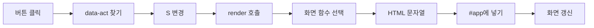

# 프로토타입 따라하기 가이드 (아주 쉬운 버전)

> 안녕하세요. 이 문서는 **코드를 처음 보는 분도 따라 할 수 있게** 만든 아주 쉬운 가이드예요.
>
> 목표는 딱 하나입니다.
>
> **8개 파일을 직접 만들고, 브라우저에서 화면이 나오게 한다.**
>
> 코드를 전부 외울 필요는 없어요. **복사 → 실행 → 설명 읽기** 순서로 천천히 따라오세요. 이해가 안 되는 줄은 일단 넘어가도 괜찮습니다. 나중에 다시 보면 조금씩 보여요.
>
> 이 문서에는 설명을 위해 프로토타입 코드가 그대로 들어 있습니다. 실제 공동 저장소에는 파일을 그대로 올리지 않고, 구조와 원리만 참고합니다.

---

## 0. 딱 3줄로 이해하기

이 앱은 아주 단순한 규칙으로 움직입니다.

1. **`S`는 앱의 메모장이다.** 지금 어느 화면인지, 검색어가 뭔지 적어 둔다.
2. **버튼을 누르면 메모를 바꾼다.** 예: `S.screen = "detail"`.
3. **`render()`가 메모를 보고 화면을 다시 그린다.**

이게 전부예요. 정말로요.

### 아주 작은 예제

아래 코드를 `test.html`로 저장해서 열어 보세요.

```html
<!doctype html>
<html lang="ko">
<body>
  <div id="app"></div>

  <script>
    // 1. 메모장
    const S = { count: 0 };

    // 2. 메모를 보고 화면을 그리는 함수
    function render() {
      document.getElementById("app").innerHTML =
        `<button id="plus">${S.count}</button>`;

      document.getElementById("plus").addEventListener("click", () => {
        // 3. 메모를 바꾸고
        S.count = S.count + 1;
        // 4. 다시 그린다
        render();
      });
    }

    // 5. 처음 한 번 그린다
    render();
  </script>
</body>
</html>
```

- 버튼을 누를 때마다 숫자가 1씩 올라갑니다.
- 숫자는 `S.count`에 저장되어 있습니다.
- 화면은 `render()`가 `S.count`를 읽어서 다시 그립니다.

> **이 예제가 이해되면 프로토타입의 80%를 이해한 거예요.** 나머지는 “화면이 여러 개로 늘어난 것”뿐입니다.

### 이 문서에서 꼭 가져갈 것 5개

코드가 길어 보여도 전부 외울 필요는 없어요. 아래 다섯 개만 이해하면 됩니다.

1. **`S`가 바뀌면 화면이 바뀐다.** (`render()`가 다시 그린다)
2. **화면 함수는 HTML을 글자로 돌려준다.** (`search()`, `detail()`, `map()`, `admin()`)
3. **버튼에는 `data-act`라는 이름표가 붙는다.** (`app.js`가 읽는다)
4. **`S`를 바꾼 뒤에는 `render()`를 부른다.** (안 부르면 화면이 그대로다)
5. **사용자 입력을 HTML에 넣을 때는 `esc()`를 거친다.** (XSS 방지)

나머지 `map.js`의 수학, CSS의 세부 속성은 **나중에 하나씩** 익혀도 됩니다. 지금은 “이런 게 있구나” 정도만 봐도 충분해요.

---

## 1. 파일 8개를 준비하세요

빈 폴더 하나를 만들고 아래 8개 파일을 만드세요. **모두 같은 폴더에** 있어야 합니다.

```
my-app/
├─ index.html
├─ base.css
├─ theme.css
├─ data.js
├─ state.js
├─ map.js
├─ screens.js
└─ app.js
```

### 각 파일이 하는 일

| 파일 | 아주 쉬운 설명 |
|---|---|
| `index.html` | 뼈대. “여기에 화면을 그려 주세요”라고 상자를 만든다 |
| `base.css` | 기본 디자인. 색, 여백, 버튼 모양 |
| `theme.css` | 디자인 덧칠. 기본 디자인 위에 테마를 입힌다 |
| `data.js` | 재료. 장소, 건물, 경로, 안내 문장 |
| `state.js` | 메모장. 지금 화면, 검색어, 단계 번호 |
| `map.js` | 지도 그림을 그리는 함수 |
| `screens.js` | 화면별 HTML을 글자로 만드는 함수 |
| `app.js` | 버튼을 눌렀을 때 메모를 바꾸고 화면을 다시 그린다 |

### 불러오는 순서

`index.html`에서 아래 순서로 불러옵니다.

```
data.js → state.js → map.js → screens.js → app.js
```

뒤에 있는 파일이 앞 파일을 사용하기 때문이에요. **순서를 바꾸면 오류가 납니다.**

---

## 2. `index.html` — 화면의 뼈대

이 파일은 **디자인을 직접 하지 않습니다.** CSS와 JS를 불러오고, 화면이 그려질 빈 상자만 만듭니다.

### 전체 코드

```html
<!DOCTYPE html>
<!--
  ============================================================
  마지막 도보 구간 안내 프로토타입 (파일 분리 버전)
  ============================================================
  이전에는 파일 하나에 모두 들어 있던 코드를 역할별로 나눴습니다.

    index.html   : 페이지 뼈대. CSS와 JS 파일을 불러오는 역할만 합니다.
    base.css     : 기본 디자인
    theme.css    : 디자인 덮어쓰기 (base.css 다음에 불러옵니다)
    data.js      : 샘플 데이터
    state.js     : 앱 상태(S)
    map.js       : 2.5D 지도 그리기
    screens.js   : 화면별 HTML 만들기
    app.js       : render(), 클릭/입력 처리, 시작

  ★ 중요: 위 8개 파일을 반드시 "같은 폴더 한 곳"에 두세요.
    (하위 폴더 없이 한 폴더에 모두 넣고 index.html을 열면 됩니다.)

  동작 원리는 한 줄로 요약할 수 있습니다.
    "S(상태)를 바꾸고 → render()로 화면을 통째로 다시 그린다"

  ※ 샘플 데이터이므로 실제 API와는 연결되어 있지 않습니다.
  ※ 지도는 MapLibre가 아니라 SVG로 흉내 낸 2.5D 그림입니다. (시연용)
  ※ 실행 방법: index.html을 브라우저로 열면 됩니다. (서버 설치가 필요 없습니다)
-->
<html lang="ko"><!-- lang="ko": 브라우저와 스크린리더에 한국어 페이지임을 알려줍니다 -->
<head>
<meta charset="utf-8"><!-- 글자 깨짐을 방지합니다. 한글을 쓸 때는 반드시 필요합니다 -->

<!-- 모바일 화면 설정입니다. 이 줄이 없으면 휴대폰에서 PC 화면처럼 작게 표시됩니다.
     viewport-fit=cover : 노치(화면이 파인 부분)까지 화면으로 사용하겠다는 뜻입니다 -->
<meta name="viewport" content="width=device-width, initial-scale=1, viewport-fit=cover">
<title>마지막 도보 구간 안내 프로토타입</title><!-- 브라우저 탭에 표시되는 제목입니다 -->

<!-- 1) 기본 디자인 -->
<link rel="stylesheet" href="base.css">

<!-- 구글 폰트를 불러옵니다. preconnect는 "곧 이 서버에서 받을 예정"이라고 미리 연결해 두는 설정이라 조금 더 빨라집니다.
     폰트를 받지 못해도 font-family의 대체 글꼴로 표시되므로 앱이 깨지지 않습니다. -->
<link rel="preconnect" href="https://fonts.googleapis.com"><link rel="preconnect" href="https://fonts.gstatic.com" crossorigin>
<link rel="stylesheet" href="https://fonts.googleapis.com/css2?family=Do+Hyeon&family=IBM+Plex+Sans+KR:wght@400;600&display=swap">

<!-- 2) 디자인 덮어쓰기. CSS는 "나중에 쓴 규칙이 우선한다"는 원칙이 있으므로 반드시 base.css 뒤에 둡니다. -->
<link rel="stylesheet" href="theme.css">
</head>

<body>
<!-- 화면이 그려질 빈 상자입니다. JavaScript가 이 안을 채워 넣습니다. -->
<div id="app"></div>

<!-- JavaScript 파일은 "위에서 아래로" 순서대로 실행됩니다.
     뒤 파일이 앞 파일의 변수를 사용하므로 순서를 바꾸면 오류가 납니다.
     (data → state → map → screens → app 순서) -->
<script src="data.js"></script>
<script src="state.js"></script>
<script src="map.js"></script>
<script src="screens.js"></script>
<script src="app.js"></script><!-- 마지막 파일입니다. 맨 끝에서 render()를 호출해 앱을 시작합니다. -->

<!-- 파일 연결 점검용입니다. JS 파일이 제대로 불러와졌다면 render 함수가 존재합니다.
     없다면 파일이 빠졌거나 폴더가 다르다는 뜻이므로, 빈 화면 대신 안내 문구를 보여 줍니다. -->
<script>
if(typeof render!=="function"){
  document.getElementById("app").innerHTML='<p style="padding:16px;font-family:sans-serif">파일을 불러오지 못했어요.<br>index.html과 같은 폴더에 base.css, theme.css, data.js, state.js, map.js, screens.js, app.js가 모두 있는지 확인해 주세요.</p>';
}
</script>
</body>
</html>
```

### 한 줄씩 설명

| 코드 | 뜻 |
|---|---|
| `<!DOCTYPE html>` | “이 문서는 HTML5예요”라고 알려 준다 |
| `<html lang="ko">` | 한국어 문서라고 알려 준다 |
| `<meta charset="utf-8">` | 한글이 깨지지 않게 한다 |
| `<meta name="viewport" ...>` | 휴대폰 화면 폭에 맞춘다 |
| `<link rel="stylesheet" href="base.css">` | 기본 디자인을 불러온다 |
| `<link rel="stylesheet" href="theme.css">` | 테마 디자인을 **나중에** 불러온다 |
| `<div id="app"></div>` | JS가 화면을 채울 빈 상자 |
| `<script src="data.js"></script>` | 재료를 먼저 불러온다 |
| `<script src="app.js"></script>` | 마지막에 앱을 시작한다 |

### 왜 `theme.css`를 나중에 불러오나요?

CSS는 **나중에 쓴 규칙이 이기는** 경우가 많아요. `base.css`로 기본을 만들고, `theme.css`로 덧칠하려면 테마가 나중에 와야 합니다.

### 왜 `#app`은 비어 있나요?

화면을 JavaScript가 만들기 때문이에요. `index.html`은 “빈 캔버스”이고, `render()`가 그림을 그립니다.

### 실행해 보기

`index.html`을 열면 **아직 아무것도 안 보이는 게 정상**입니다. `app.js`가 아직 없거나, `render()`가 아직 화면을 안 그렸을 수 있어요. 파일을 다 만든 뒤 마지막에 확인합니다.

### 여기서 막히면

- 8개 파일이 정말 같은 폴더에 있나요?
- 파일 이름이 `base.css`인데 `Base.css`처럼 대소문자가 다르지 않나요?
- `script` 순서가 `data → state → map → screens → app`인가요?

---

## 3. `data.js` — 앱의 재료

이 파일은 **서버에서 받아올 데이터를 임시로 적어 둔 곳**입니다.

### 전체 코드

```js
/* data.js : 샘플 데이터입니다. 실제 앱에서는 서버(API)에서 받아올 값들을 임시로 적어 둔 파일입니다.
   (여러 JS 파일은 index.html에서 정해진 순서로 불러오며, 같은 전역 변수를 함께 사용합니다) */
/* ============================================================
   1. 샘플 데이터
   ============================================================
   실제 앱에서는 이 값들이 서버(API)에서 내려옵니다. 지금은 코드에 직접 적어 둔 값입니다.
   const는 "다시 대입할 수 없는 변수"입니다. 배열은 [ ], 객체는 { }로 표현합니다. */

// 장소 목록입니다. route:true인 장소만 도보 경로가 있는 것으로 가정합니다.
const PLACES=[
 {id:1,name:"공학관 (샘플)",addr:"학교 내 시연 지역",route:true},
 {id:2,name:"학생회관 (샘플)",addr:"학교 내 시연 지역",route:false},
 {id:3,name:"체육관 (샘플)",addr:"학교 내 시연 지역",route:false}];

// 건물 목록입니다. b:[x0,y0,x1,y1]은 바닥 사각형의 두 모서리 좌표, f는 층수, t:true는 목적 건물을 뜻합니다.
// 좌표는 0~10 정도의 가상 격자 값이며 실제 위경도가 아닙니다.
const BUILDINGS=[
 {n:"카페",b:[0,2,2,4],f:1},{n:"도서관",b:[4,6,6,8],f:2},{n:"공학관",b:[5,1,9,4],f:3,t:true}];

const PARK={x:1.5,y:7.5,w:[0,6,3,9]}; // 주차장: 중심 좌표(x,y)와 바닥 사각형(w)
const ENT={x:7,y:4};                  // 입구 좌표
// 도보 경로입니다. 점(좌표)들을 순서대로 이은 것이며, 첫 점은 주차장, 마지막 점은 입구입니다.
const ROUTE=[[1.5,7.5],[3.5,7.5],[3.5,5],[7,5],[7,4]];

// 경로 단계별 안내 문장입니다. 관리자 화면에서 수정하면 값이 바뀌므로 let으로 선언했습니다. (let은 다시 대입할 수 있는 변수입니다)
let steps=[
 "주차장 출구로 나와 도서관 쪽으로 걸어가세요.",
 "도서관 모서리에서 카페를 왼쪽에 두고 앞으로 가세요.",
 "공학관 앞 광장이 보이면 건물 쪽으로 오른쪽으로 도세요.",
 "공학관 입구에 도착했어요. 입구 문을 찾으세요."];
```

### 데이터를 표로 보기

#### 장소 목록 `PLACES`

| 이름 | 뜻 |
|---|---|
| `id` | 장소 번호 |
| `name` | 장소 이름 |
| `addr` | 주소 |
| `route` | 도보 경로가 있는지 (`true`/`false`) |

#### 건물 목록 `BUILDINGS`

| 이름 | 뜻 |
|---|---|
| `n` | 건물 이름 |
| `b` | 바닥 사각형 `[x0, y0, x1, y1]` |
| `f` | 층수 |
| `t` | 목적 건물이면 `true` |

#### 주차장, 입구, 경로

- `PARK`: 주차장 위치
- `ENT`: 입구 위치
- `ROUTE`: 경로 점들의 목록

#### 안내 문장 `steps`

```js
let steps = [
  "주차장 출구로 나와 도서관 쪽으로 걸어가세요.",
  ...
];
```

`steps`는 `let`입니다. 관리자 화면에서 **배열을 통째로 바꿀 수 있어야** 하기 때문이에요.

### `const`와 `let` 차이

```js
const name = "공학관"; // 다시 다른 값으로 바꿀 수 없음
let count = 0;         // 나중에 count = 1로 바꿀 수 있음
```

- `const`: 한 번 정하면 다른 값으로 **재대입** 불가
- `let`: 나중에 다른 값으로 **재대입** 가능

### 바꿔 보기

`PLACES`의 첫 번째 장소 이름을 `"공학관"`으로 바꿔 보세요. 검색 결과에 바로 반영됩니다.

---

## 4. `state.js` — 앱의 메모장

이 파일은 **지금 앱이 어떤 상태인지** 적어 두는 곳입니다.

### 전체 코드

```js
/* state.js : 앱의 상태(S)를 모아 둔 파일입니다. 화면은 항상 이 값을 보고 그려집니다.
   (여러 JS 파일은 index.html에서 정해진 순서로 불러오며, 같은 전역 변수를 함께 사용합니다) */
/* ============================================================
   2. 상태(State): 이 앱의 '기억 장치'
   ============================================================
   앱의 현재 상태를 모두 S 객체 하나에 모아 둡니다.
   화면은 항상 "S를 보고 그린 결과"이므로, 화면을 바꾸려면 S만 바꾸면 됩니다. */
const S={
  screen:"search",   // 보여줄 화면: "search" | "detail" | "map" | "admin"
  q:"",              // 검색창에 입력한 글자
  loading:false,     // 검색 중인지 여부 (300ms 디바운스 동안 true)
  place:null,        // 사용자가 선택한 장소
  step:0,            // 지도 화면의 현재 단계 번호 (0부터 시작합니다)
  modal:null,        // 떠 있는 팝업: null(없음) | "nav" | "conflict"
  authed:false,      // 관리자 키를 입력해 로그인했는지 여부
  draft:[],          // 관리자 화면에서 수정 중인 문장들 (저장 전 임시본)
  conflict:false,    // (예비용 값이며 현재는 사용하지 않습니다)
  simConflict:false, // "409 충돌 시뮬레이션" 체크박스 상태
  saved:""           // 저장 후 보여줄 안내 문구
};
let t; // 디바운스용 타이머 번호를 보관하는 변수입니다 (아래 검색 입력 처리에서 사용합니다)
```

### `S` 안에 뭐가 있나요?

| 값 | 뜻 | 예 |
|---|---|---|
| `screen` | 지금 화면 | `"search"`, `"detail"`, `"map"`, `"admin"` |
| `q` | 검색어 | `"공학"` |
| `loading` | 검색 중인지 | `true` / `false` |
| `place` | 선택한 장소 | `{ id: 1, name: "공학관" }` |
| `step` | 지금 몇 번째 단계인지 | `0`, `1`, `2`, `3` |
| `modal` | 열린 팝업 | `null`, `"nav"`, `"conflict"` |
| `authed` | 관리자 로그인 여부 | `true` / `false` |
| `draft` | 수정 중인 문장 | `["문장1", "문장2"]` |
| `saved` | 저장 안내 문구 | `"저장했어요"` |

### 상태가 바뀌면 화면이 바뀐다

예를 들어 버튼을 눌러 `S.screen = "detail"`로 바꾸고 `render()`를 부르면, 상세 화면이 그려집니다.

```js
S.screen = "detail";
render();
```

### 연습

`S`에 `error: ""`를 추가해 보세요. 나중에 오류 메시지를 저장할 때 쓸 수 있습니다.

```js
const S = {
  // ...
  error: "",
};
```

---

## 5. `map.js` — 비스듬한 2.5D 지도

이 파일이 제일 어려워 보이지만, 원리는 간단합니다.

> **평면 좌표를 비스듬히 내려다본 것처럼 바꿔서 그린다.**

> **전부 이해하지 않아도 됩니다.** `P`, `box`, `mapSvg` 세 함수의 이름과 역할만 기억하세요. 나머지는 “이런 계산을 하는구나” 정도로 넘어가도 돼요.

### 전체 코드

```js
/* map.js : 2.5D 지도(SVG)를 그리는 함수들입니다. data.js의 좌표를 사용합니다.
   (여러 JS 파일은 index.html에서 정해진 순서로 불러오며, 같은 전역 변수를 함께 사용합니다) */
/* ============================================================
   3. 2.5D 지도 그리기 (등각 투영, isometric)
   ============================================================
   평면 좌표(x,y)를 "비스듬히 내려다본 화면 좌표"로 바꾸면 입체처럼 보입니다.
   원리: x가 늘어나면 오른쪽 아래로, y가 늘어나면 왼쪽 아래로 이동하고, 높이(z)는 위로 올립니다. */
const U=20;   // 격자 1칸이 화면에서 몇 px인지 나타내는 크기 배율입니다
const FH=13;  // 건물 1층의 높이(px)입니다

// P(x,y,z): 가상 좌표를 SVG 화면 좌표 [가로, 세로]로 변환하는 함수입니다.
//  .866은 cos(30°), .5는 sin(30°)이며 등각 투영의 각도 값입니다.
//  z=0은 "기본값 0"이라는 뜻이므로, 높이를 넘기지 않으면 바닥 높이로 계산됩니다.
//  toFixed(1)은 소수점 한 자리로 줄여서 SVG 문자열이 지나치게 길어지는 것을 막습니다.
const P=(x,y,z=0)=>[(180+(x-y)*U*.866).toFixed(1),(30+(x+y)*U*.5-z).toFixed(1)];

// pts(점들): [[10,20],[30,40]] 같은 배열을 "10,20 30,40" 문자열로 바꿉니다. SVG의 points 속성 형식입니다.
const pts=a=>a.map(p=>p.join(",")).join(" ");

// box(바닥사각형, 높이, 색): 건물 하나를 세 면(왼쪽, 오른쪽, 윗면)의 polygon으로 그려 문자열로 돌려줍니다.
function box(b,h,fill){
 const[x0,y0,x1,y1]=b; // 배열 b를 변수 4개로 한 번에 풀어 담습니다 (구조 분해)
 // 같은 색을 쓰되 brightness(밝기) 필터로 면마다 어둡기를 다르게 해서 입체감을 냅니다.
 return `<polygon points="${pts([P(x0,y1,0),P(x1,y1,0),P(x1,y1,h),P(x0,y1,h)])}" fill="${fill}" style="filter:brightness(.85)"/>
 <polygon points="${pts([P(x1,y0,0),P(x1,y1,0),P(x1,y1,h),P(x1,y0,h)])}" fill="${fill}" style="filter:brightness(.7)"/>
 <polygon points="${pts([P(x0,y0,h),P(x1,y0,h),P(x1,y1,h),P(x0,y1,h)])}" fill="${fill}"/>`
 // 위 순서는 왼쪽 면(.85), 오른쪽 면(.7, 가장 어두움), 윗면(원래 밝기)입니다.
}

// mapSvg(i): 지도 전체 SVG 문자열을 만들어 돌려줍니다. i는 "현재 몇 번째 단계인지"를 뜻합니다.
function mapSvg(i){
 const[a,b,c,d]=PARK.w; // 주차장 바닥 사각형 좌표

 // 건물은 "뒤에 있는 것부터" 그려야 앞 건물이 뒤 건물을 올바르게 가립니다. 그래서 (x0+y0)가 작은 순으로 정렬합니다.
 // [...BUILDINGS]는 원본 배열을 건드리지 않기 위해 복사본을 만드는 문법입니다.
 const bs=[...BUILDINGS]
   .sort((m,n)=>(m.b[0]+m.b[1])-(n.b[0]+n.b[1]))
   .map(o=>box(o.b,o.f*FH,o.t?"var(--target)":"var(--bld)")) // 목적 건물이면 강조색, 아니면 회색입니다. 높이는 층수 × 13px입니다.
   .join("");

 const all=pts(ROUTE.map(p=>P(p[0],p[1])));              // 경로 전체 (연한 점선용)
 const done=pts(ROUTE.slice(0,i+2).map(p=>P(p[0],p[1]))); // 현재 단계까지 지나온 경로만 (slice로 앞에서 i+2개를 자릅니다)
 const cur=P(...ROUTE[Math.min(i+1,ROUTE.length-1)]);     // 현재 위치 점입니다. ...은 배열을 낱개 인자로 펼치는 문법이고, Math.min은 배열 범위를 넘지 않게 막아 줍니다.
 const pk=P(PARK.x,PARK.y,0),en=P(ENT.x,ENT.y,0);         // 주차장과 입구 마커의 화면 좌표

 // ${...} 안에는 변수나 계산식을 넣을 수 있습니다 (템플릿 문자열). 그래서 SVG를 조립할 때 편리합니다.
 return `<svg class="map" viewBox="0 0 360 250" role="img" aria-label="2.5D 지도. 주차장에서 공학관 입구까지 경로">
 <polygon points="${pts([P(a,b),P(c,b),P(c,d),P(a,d)])}" fill="var(--line)"/>
 <polyline points="${all}" fill="none" stroke="var(--route)" stroke-width="3" stroke-dasharray="2 6" stroke-linecap="round" opacity=".5"/>
 <polyline points="${done}" fill="none" stroke="var(--card)" stroke-width="9" stroke-linecap="round" stroke-linejoin="round"/>
 <polyline points="${done}" fill="none" stroke="var(--route)" stroke-width="4" stroke-linecap="round" stroke-linejoin="round"/>
 ${bs}
 <g transform="translate(${pk[0]-11},${pk[1]-11})"><rect width="22" height="22" rx="4" fill="var(--park)"/><text x="11" y="16" text-anchor="middle" font-size="14" font-weight="700" fill="#fff">P</text></g>
 <g transform="translate(${en[0]},${en[1]})"><path d="M0-14 L12 0 L0 14 L-12 0Z" fill="var(--ent)" stroke="#fff" stroke-width="1.5"/><rect x="-3" y="-5" width="6" height="10" rx="1" fill="#fff"/></g>
 <text class="lb" x="${+en[0]+16}" y="${+en[1]+4}">입구</text><text class="lb" x="${+pk[0]+16}" y="${+pk[1]+5}">주차장</text>
 <circle cx="${cur[0]}" cy="${cur[1]}" r="6" fill="#fff" stroke="var(--route)" stroke-width="3"/>
 </svg>`
 // 위 SVG의 구성입니다. 위에서 아래로 그려지므로 아래에 있는 요소가 위에 겹쳐 보입니다.
 //  1) 주차장 바닥(회색 평면)  2) 전체 경로(연한 점선)  3) 지나온 경로의 흰 테두리(굵게)  4) 지나온 경로의 초록 선
 //  5) 건물들  6) 주차장 마커(파란 P 사각형)  7) 입구 마커(앰버색 마름모와 문)  8) 글자 라벨  9) 현재 위치 점
 // `+en[0]`의 앞쪽 +는 "문자열을 숫자로 바꾼다"는 뜻입니다. toFixed의 결과가 문자열이라서, 더하기 전에 숫자로 바꿔야 합니다.
 // 색만으로 구분하기 어려운 사용자를 위해 주차장은 '사각형과 P', 입구는 '마름모와 문'으로 모양도 다르게 했습니다.
}

// 범례 HTML입니다. 지도 마커와 같은 모양의 작은 아이콘과 설명 글자로 구성됩니다.
const legend=`<div class="legend" aria-label="범례">
 <span><svg width="18" height="18"><rect x="1" y="1" width="16" height="16" rx="3" fill="var(--park)"/><text x="9" y="13" text-anchor="middle" font-size="11" font-weight="700" fill="#fff">P</text></svg>주차장</span>
 <span><svg width="18" height="18"><path d="M9 1L17 9 9 17 1 9Z" fill="var(--ent)"/><rect x="6.5" y="6" width="5" height="6" fill="#fff"/></svg>입구</span>
 <span><svg width="18" height="18"><rect x="2" y="5" width="14" height="10" fill="var(--target)"/></svg>목적 건물</span>
 <span><svg width="22" height="18"><line x1="1" y1="9" x2="21" y2="9" stroke="var(--route)" stroke-width="4" stroke-linecap="round"/></svg>도보 경로</span></div>`;
```

### 핵심 함수 `P(x, y, z)`

```js
const P = (x, y, z = 0) => [
  (180 + (x - y) * U * 0.866).toFixed(1),
  (30 + (x + y) * U * 0.5 - z).toFixed(1)
];
```

- `x`가 커지면 **오른쪽 아래**로 갑니다.
- `y`가 커지면 **왼쪽 아래**로 갑니다.
- `z`가 커지면 **위**로 갑니다.
- `0.866`은 `cos(30°)`, `0.5`는 `sin(30°)`입니다.

> 외우지 마세요. “비스듬히 보는 좌표 변환”이라는 것만 기억하면 됩니다.

### 건물 상자 `box()`

건물 하나를 **세 면**으로 그립니다.

1. 왼쪽 면 (조금 어둡게)
2. 오른쪽 면 (가장 어둡게)
3. 윗면 (원래 밝기)

```js
< polygon ... fill="..." style="filter:brightness(.85)" />
```

색을 세 개 고르는 대신, 한 색의 밝기만 바꿔서 입체감을 냅니다.

### 지도 조립 `mapSvg(i)`

`i`는 현재 단계 번호입니다.

- 전체 경로: 연한 점선
- 지나온 경로: 초록 선
- 현재 위치: 흰 점
- 건물: 뒤에서 앞으로 그리기
- 주차장/입구: 마커와 글자

### SVG 태그 아주 짧게

| 태그 | 뜻 |
|---|---|
| `<polygon>` | 다각형 |
| `<polyline>` | 이어진 선 |
| `<circle>` | 원 |
| `<text>` | 글자 |
| `<g>` | 여러 요소를 묶는 상자 |

### 바꿔 보기

`const U = 20;`을 `30`으로 바꾸면 지도가 커집니다. `FH`를 `20`으로 바꾸면 건물이 높아집니다.

---

## 6. `screens.js` — 화면별 HTML 만들기

이 파일의 함수들은 **HTML을 글자로 돌려줍니다.**

```js
function search() {
  return `<h1>어디로 가세요?</h1>...`;
}
```

`render()`가 이 글자를 `#app` 안에 넣습니다.

> **이 파일은 함수가 여러 개라 길어 보이지만, 패턴은 같습니다.** “이 상태면 이 HTML을 돌려준다”만 보면 됩니다. `esc`, `search`, `detail`, `map`, `admin`, `modal` 여섯 개만 기억하세요.

### 전체 코드

```js
/* screens.js : 화면별 HTML 문자열을 만드는 함수들입니다. state.js, data.js, map.js를 사용합니다.
   (여러 JS 파일은 index.html에서 정해진 순서로 불러오며, 같은 전역 변수를 함께 사용합니다) */
/* ============================================================
   4. 화면을 만드는 함수들
   ============================================================
   각 함수는 "해당 화면의 HTML 문자열"을 돌려줍니다. (React의 컴포넌트와 비슷한 역할입니다)
   실제로 화면에 그리는 일은 아래의 render()가 담당합니다. */

// esc(글자): 사용자가 입력한 글자를 화면에 넣기 전에 안전한 형태로 바꿉니다.
// <, > 같은 특수문자를 그대로 넣으면 악성 코드(XSS)가 실행될 수 있으므로 반드시 필요한 처리입니다.
const esc=s=>s.replace(/[&<>"]/g,c=>({"&":"&amp;","<":"&lt;",">":"&gt;",'"':"&quot;"}[c]));

// [검색 화면] 로딩, 빈 입력, 결과 없음, 결과 있음의 네 가지 상태를 모두 처리합니다.
function search(){
 // 입력한 글자가 이름에 포함된 장소만 걸러냅니다 (filter)
 const list=PLACES.filter(p=>p.name.includes(S.q.trim()));
 let body="";
 if(!S.q.trim())body=`<p class="sub">검색어를 입력해 주세요. (예: 공학)</p>`;           // 아직 입력이 없는 상태
 else if(S.loading)body=`<p>검색 중…</p>`;                                              // 디바운스 대기 중
 else if(!list.length)body=`<p>“${esc(S.q)}”에 대한 결과가 없어요.</p>`;                 // 결과가 0개인 상태
 else body=list.map(p=>`<button class="item" data-act="open" data-id="${p.id}"><b>${p.name}</b><br><span class="sub">${p.addr}</span></button>`).join(""); // 결과 목록
 // data-act와 data-id는 버튼에 "이 버튼은 어떤 동작을 한다"는 꼬리표를 붙여 둔 것입니다. 아래의 클릭 처리에서 읽어 사용합니다.
 // aria-live="polite"는 내용이 바뀌면 스크린리더가 읽어 주도록 하는 설정입니다.
 return `<h1>어디로 가세요?</h1><input id="q" type="search" value="${esc(S.q)}" placeholder="장소 이름을 입력하세요" aria-label="장소 검색"><div style="margin-top:12px" aria-live="polite">${body}</div>`}

// [상세 화면] 장소 정보, 내비 열기, 도보 경로 보기를 제공합니다.
function detail(){
 const p=S.place;
 // ${p.route?"":`...`}는 조건부 표시입니다. 경로가 없는 장소이면 "준비되지 않았어요" 안내를 보여 줍니다.
 // 경로가 없으면 "도보 경로 보기" 버튼은 disabled(누를 수 없는 상태)로 처리합니다.
 return `<button data-act="go" data-to="search">← 검색으로</button><h1 style="margin-top:12px">${p.name}</h1>
 <div class="card"><div class="sub">주소</div>${p.addr}<hr style="border:0;border-top:1px solid var(--line);margin:10px 0"><div class="sub">시설 (샘플)</div><div class="fac"><svg width="22" height="22"><rect x="1" y="1" width="20" height="20" rx="4" fill="var(--park)"/><text x="11" y="16" text-anchor="middle" font-size="13" font-weight="700" fill="#fff">P</text></svg>주차장 1곳</div><div class="fac"><svg width="22" height="22"><path d="M11 1L21 11 11 21 1 11Z" fill="var(--ent)"/><rect x="8" y="7" width="6" height="8" fill="#fff"/></svg>입구 1곳</div></div>
 ${p.route?"":`<div class="card" role="status">이 장소는 아직 도보 경로 안내가 준비되지 않았어요.</div>`}
 <div class="row"><button class="primary" data-act="nav">주차장으로 내비 열기</button><button data-act="go" data-to="map" ${p.route?"":"disabled"}>도보 경로 보기</button></div>`}

// [지도 화면] 지도, 범례, 단계 안내 패널을 보여줍니다.
function map(){
 const last=S.step===steps.length-1; // 현재가 마지막 단계인지 여부 (true 또는 false)
 // steps.map((_,k)=>...)는 단계 개수만큼 진행 막대의 칸(i)을 만듭니다. 현재 단계까지는 class="on"을 붙여 초록색으로 표시합니다.
 // 버튼 disabled: 첫 단계에서는 "이전"을, 마지막 단계에서는 "다음"을 누를 수 없게 합니다.
 return `<button data-act="go" data-to="detail">← 상세</button><h1 style="margin-top:12px">${S.place.name}</h1>
 ${mapSvg(S.step)}${legend}
 <div class="sheet" aria-live="polite"><div class="seg" aria-hidden="true">${steps.map((_,k)=>`<i class="${k<=S.step?"on":""}"></i>`).join("")}</div><div class="num">${S.step+1}<span class="sub"> / ${steps.length}</span></div><div class="txt">${esc(steps[S.step])}</div>
 <div class="row"><button data-act="prev" ${S.step?"":"disabled"}>이전</button><button class="primary" data-act="next" ${last?"disabled":""}>${last?"도착":"다음"}</button></div></div>`}
 // S.step+1을 쓴 이유: 컴퓨터는 0부터 세지만 사람이 보는 숫자는 1부터 시작하기 때문입니다.

// [관리자 화면] 로그인 전에는 키 입력창, 로그인 후에는 문장 편집기를 보여줍니다.
function admin(){
 if(!S.authed)return `<h1>관리자</h1><input id="key" type="password" placeholder="관리자 키 (데모: 아무 값)" aria-label="관리자 키" autocomplete="off"><div style="margin-top:12px"><button class="primary" data-act="login">확인</button></div><p class="sub">실제 앱: X-Admin-Key 헤더, 키는 sessionStorage 보관</p>`;
 // 처음 들어오면 임시본(draft)이 비어 있으므로, 현재 문장들을 복사해서 채웁니다. [...steps]는 복사본입니다.
 if(!S.draft.length)S.draft=[...steps];
 // 단계마다 글자 수 표시(0/200)와 입력칸(textarea)을 만듭니다. maxlength=200은 API 규칙(1~200자)을 흉내 낸 값입니다.
 const rows=S.draft.map((v,i)=>`<label class="sub" for="s${i}">단계 ${i+1} <span id="c${i}">${v.length}/200</span></label><textarea id="s${i}" data-i="${i}" rows="2" maxlength="200">${esc(v)}</textarea>`).join("");
 return `<h1>안내 문장 편집</h1>${rows}
 <label class="sub" style="display:block;margin:12px 0"><input type="checkbox" id="sim" ${S.simConflict?"checked":""} style="width:auto"> 저장 시 409 충돌 시뮬레이션</label>
 <button class="primary" data-act="save">저장</button> <span class="sub" role="status">${S.saved}</span>
 <div style="margin-top:12px"><button data-act="logout">로그아웃</button></div>`}

// [팝업] S.modal 값에 따라 서로 다른 팝업을 보여줍니다. 해당 값이 없으면 빈 문자열("")을 돌려주므로 아무것도 표시되지 않습니다.
function modal(){
 // 1) 내비 앱 연결 안내 팝업입니다. 내비 앱 종류와 딥링크는 아직 미정이므로 연결 없이 안내만 합니다.
 if(S.modal==="nav")return `<div class="modal"><div role="dialog" aria-modal="true"><b>외부 내비 앱 연결</b><p class="sub">지원할 내비 앱과 딥링크 형식은 아직 미정이에요. 이 프로토타입에서는 연결 없이 다음 단계로 넘어가요.</p><div class="row"><button data-act="close">닫기</button><button class="primary" data-act="arrived">주차장에 도착했어요</button></div></div></div>`;
 // 2) 409 충돌 팝업입니다. 자동 재시도 없이 "서버 최신"과 "내 수정"을 나란히 보여 주고 사용자가 선택하게 합니다.
 if(S.modal==="conflict")return `<div class="modal"><div role="alertdialog" aria-modal="true"><b>다른 곳에서 먼저 수정되었어요 (409)</b><p class="sub">자동 재시도하지 않아요. 최신 내용과 내 수정을 비교해 주세요.</p>
 <div class="cmp"><div><b>서버 최신</b><br>${steps.map((s,i)=>`${i+1}. ${esc(s)}${i===0?" (다른 관리자 수정)":""}`).join("<br>")}</div><div><b>내 수정</b><br>${S.draft.map((s,i)=>`${i+1}. ${esc(s)}`).join("<br>")}</div></div>
 <div class="row" style="margin-top:12px"><button data-act="useServer">최신으로 되돌리기</button><button class="primary" data-act="force">내 수정 유지·다시 저장</button></div></div></div>`;
 return ""}
```

### `esc()` — 사용자 입력을 안전하게

```js
const esc = (s) =>
  s.replace(/[&<>"]/g, (c) => ({ "&": "&amp;", "<": "&lt;", ">": "&gt;", '"': "&quot;" }[c]));
```

사용자가 `<script>alert(1)</script>`를 검색창에 넣으면, 그대로 HTML에 들어갈 때 스크립트가 실행될 수 있습니다. 이걸 **XSS**라고 해요.

`esc()`는 위험한 글자를 안전한 글자로 바꿉니다. **사용자 입력을 HTML에 넣을 때는 항상 거치세요.**

### 검색 화면의 네 가지 상태

| 상태 | 화면 |
|---|---|
| 아직 입력 안 함 | “검색어를 입력해 주세요.” |
| 검색 중 | “검색 중…” |
| 결과 없음 | “결과가 없어요.” |
| 결과 있음 | 장소 목록 |

초보자는 “결과 없음”만 만들고 “아직 입력 안 함”을 빼먹기 쉬워요. **네 가지를 항상 같이 생각하세요.**

### `data-act` — 버튼의 이름표

```html
<button data-act="open" data-id="1">공학관</button>
```

- `data-act="open"`: “이 버튼을 누르면 장소를 열어라”
- `data-id="1"`: “1번 장소를 열어라”

`app.js`가 이 이름표를 읽고 일을 처리합니다.

### 상세 화면의 포인트

```js
${p.route ? "" : `<div class="card" role="status">이 장소는 아직 도보 경로 안내가 준비되지 않았어요.</div>`}
```

경로가 없으면 **이유를 보여 줍니다.** 버튼만 흐리게 하면 사용자는 “왜 안 눌리지?”라고 생각해요.

### 지도 화면의 포인트

```js
const last = S.step === steps.length - 1;
```

마지막 단계인지 확인해서 “다음” 대신 “도착”을 보여 줍니다.

### 관리자 화면의 포인트

```js
if (!S.draft.length) S.draft = [...steps];
```

처음 들어오면 현재 문장을 복사해서 편집 시작점을 만듭니다.

### 팝업 `modal()`

- `S.modal === "nav"` → 내비 안내 팝업
- `S.modal === "conflict"` → 409 비교 팝업
- 그 외 → 아무것도 안 보여 줌 (`""`)

### 바꿔 보기

검색 결과 버튼에 `data-act="open"`이 빠지면 클릭해도 아무 일이 안 일어납니다. 일부러 빼고 확인해 보세요.

---

## 7. `app.js` — 버튼과 화면을 연결

이 파일이 **앱의 두뇌**입니다. 하는 일은 세 가지예요.

1. `render()`로 화면 그리기
2. 클릭/입력 처리
3. 앱 시작

> **세 덩어리로 나눠 보세요.** `render()`, 클릭 처리, 입력 처리. 이 셋만 찾아 읽으면 됩니다.

### 전체 코드

```js
/* app.js : render(), 클릭과 입력 처리, 앱 시작을 담당합니다. 가장 마지막에 불러와야 합니다.
   (여러 JS 파일은 index.html에서 정해진 순서로 불러오며, 같은 전역 변수를 함께 사용합니다) */
/* ============================================================
   5. render(): 화면을 실제로 그리는 함수
   ============================================================
   S.screen 값에 맞는 화면 함수를 골라 실행하고, 그 결과(HTML 문자열)를 #app 안에 통째로 넣습니다.
   상태(S)를 바꾼 뒤에는 항상 render()를 호출해야 화면이 갱신됩니다. */
function render(){
 // {search,detail,map,admin}["map"]처럼 객체에서 이름으로 함수를 골라 바로 실행합니다. (if를 여러 개 쓰는 대신 사용하는 간결한 방식입니다)
 const v={search,detail,map,admin}[S.screen]();
 // 하단 탭입니다. admin 화면이면 "관리자" 탭을, 나머지는 "사용자" 탭을 현재 탭(aria-current)으로 표시합니다.
 const tab=S.screen==="admin"?"admin":"user";
 document.getElementById("app").innerHTML=`<div class="banner">프로토타입 초안 · 샘플 데이터 · 와이어프레임 미확정</div><main>${v}</main>
 <nav><button data-act="go" data-to="search" ${tab==="user"?'aria-current="page"':""}>사용자</button><button data-act="go" data-to="admin" ${tab==="admin"?'aria-current="page"':""}>관리자</button></nav>${modal()}`;
}

/* ============================================================
   6. 클릭 처리: 이벤트 위임(event delegation)
   ============================================================
   버튼마다 클릭 코드를 따로 붙이면, render()로 화면을 다시 그릴 때마다 사라져서 번거롭습니다.
   그래서 "문서 전체"에서 클릭을 한 번만 받고, 눌린 곳에서 가장 가까운 [data-act] 요소를 찾아 처리합니다. */
document.addEventListener("click",e=>{
 const b=e.target.closest("[data-act]"); // 눌린 요소(또는 그 부모) 중 data-act가 있는 요소를 찾습니다
 if(!b)return;                           // 없으면 처리할 클릭이 아니므로 그대로 끝냅니다
 const a=b.dataset.act;                  // data-act="open"이면 a에는 "open"이 담깁니다

 // 동작 이름(a)에 따라 상태(S)만 바꿉니다. 화면 갱신은 맨 아래의 render()가 한 번에 처리합니다.
 if(a==="go"){S.screen=b.dataset.to}                                            // 화면 이동
 else if(a==="open"){S.place=PLACES.find(p=>p.id==b.dataset.id);S.step=0;S.screen="detail"} // 장소 선택 후 상세 화면으로 이동
 else if(a==="nav"){S.modal="nav"}                                              // 내비 안내 팝업 열기
 else if(a==="close"){S.modal=null}                                             // 팝업 닫기
 else if(a==="arrived"){S.modal=null;S.step=0;S.screen="map"}                   // "주차장에 도착" 후 지도 화면으로 이동
 else if(a==="next"){S.step=Math.min(S.step+1,steps.length-1)}                  // 다음 단계 (마지막 단계를 넘지 않게 합니다)
 else if(a==="prev"){S.step=Math.max(S.step-1,0)}                               // 이전 단계 (0 아래로 내려가지 않게 합니다)
 else if(a==="login"){S.authed=true}                                            // 관리자 로그인 (데모이므로 아무 값이나 통과합니다)
 else if(a==="logout"){S.authed=false;S.draft=[]}                               // 로그아웃과 임시본 삭제
 else if(a==="save"){
  // 저장 버튼입니다. 체크박스가 켜져 있으면 "다른 사람이 먼저 수정한 상황"을 만들어 충돌 팝업을 띄웁니다.
  S.simConflict=document.getElementById("sim").checked;
  if(S.simConflict){
   steps=[...steps];
   // 서버 최신 문장 앞에 [다른 관리자가 수정한 문장]을 붙여 "누군가 먼저 고쳤다"는 상황을 흉내 냅니다.
   // replace(정규식)는 이미 붙어 있는 [..] 꼬리표를 먼저 지워서, 여러 번 눌러도 중복되지 않게 합니다.
   steps[0]="[다른 관리자가 수정한 문장] "+steps[0].replace(/^\[.*?\]\s*/,"");
   S.modal="conflict";
  }else{steps=[...S.draft];S.saved="저장했어요"} // 충돌이 없으면 그대로 저장합니다 (임시본을 실제 문장으로 반영)
 }
 else if(a==="useServer"){S.draft=[...steps];S.modal=null;S.simConflict=false;S.saved="최신 내용으로 불러왔어요"} // 서버 최신 내용으로 되돌리기
 else if(a==="force"){steps=[...S.draft];S.modal=null;S.simConflict=false;S.saved="저장했어요"}                  // 내 수정을 유지한 채 다시 저장

 render(); // 상태를 바꿨으므로 화면을 다시 그립니다
});

/* ============================================================
   7. 입력 처리: 검색창과 관리자 문장 입력
   ============================================================ */
document.addEventListener("input",e=>{
 if(e.target.id==="q"){
  // ── 검색창 (디바운스 300ms) ──
  // 디바운스는 타이핑을 멈추고 300ms가 지난 뒤에 검색하는 방식입니다. 글자 하나를 칠 때마다 서버 요청이 나가는 것을 막아 줍니다.
  S.q=e.target.value;
  S.loading=true;
  clearTimeout(t);           // 이전 타이머를 취소합니다 (300ms가 지나기 전에 다시 입력했으므로)
  t=setTimeout(()=>{         // 300ms 뒤에 실행할 작업을 예약합니다
   S.loading=false;
   // render()로 화면을 다시 그리면 입력창도 새로 만들어져서 커서와 포커스가 사라집니다.
   // 그래서 다시 그리기 전에 커서 위치를 저장해 두었다가, 그린 뒤에 복구합니다.
   const x=document.getElementById("q");const pos=x?x.selectionStart:0;
   render();
   const n=document.getElementById("q");
   if(n){n.focus();n.setSelectionRange(pos,pos)}
  },300);
  // 타이핑하는 동안에는 화면 전체를 다시 그리지 않고 결과 영역만 "검색 중…"으로 바꿔서 입력이 끊기지 않게 합니다.
  const m=document.querySelector("main [aria-live]");
  if(m)m.innerHTML=S.q.trim()?"<p>검색 중…</p>":'<p class="sub">검색어를 입력해 주세요. (예: 공학)</p>';
 }
 else if(e.target.dataset.i!==undefined){
  // ── 관리자 문장 입력칸 ── (data-i가 있는 textarea)
  const i=+e.target.dataset.i;                  // 몇 번째 단계인지 (문자열을 숫자로 변환)
  S.draft[i]=e.target.value;                    // 임시본에 바로 반영합니다
  document.getElementById("c"+i).textContent=e.target.value.length+"/200"; // 글자 수 표시만 갱신합니다 (render를 부르지 않는 이유는 커서가 튀기 때문입니다)
  S.saved="";                                   // 다시 수정했으므로 "저장했어요" 문구는 지웁니다
 }
});

// 마지막 줄입니다. 처음 한 번 화면을 그려서 앱을 시작합니다.
render();
```

### `render()` — 화면을 그리는 함수

```js
function render() {
  const v = { search, detail, map, admin }[S.screen]();
  document.getElementById("app").innerHTML = `...${v}...`;
}
```

- `S.screen`이 `"search"`면 `search()`를 실행합니다.
- `S.screen`이 `"detail"`면 `detail()`을 실행합니다.
- 나온 HTML을 `#app`에 통째로 넣습니다.

### 클릭 처리 — 딱 3단계

```js
document.addEventListener("click", (e) => {
  const b = e.target.closest("[data-act]");
  if (!b) return;

  const a = b.dataset.act;

  if (a === "go") {
    S.screen = b.dataset.to;
  } else if (a === "open") {
    S.place = PLACES.find((p) => p.id == b.dataset.id);
    S.step = 0;
    S.screen = "detail";
  }
  // ...

  render();
});
```

1. 클릭된 요소에서 가장 가까운 `data-act`를 찾는다.
2. `data-act` 값에 따라 `S`를 바꾼다.
3. 마지막에 `render()`를 한 번 부른다.

> **“클릭 → S 변경 → render()”** 이 세 단어만 기억하세요.

### 왜 버튼마다 이벤트를 안 붙이나요?

`render()`가 화면을 다시 그릴 때마다 버튼이 새로 만들어집니다. 버튼마다 이벤트를 붙이면 그때마다 다시 붙여야 해요. 그래서 **문서 전체에서 클릭을 한 번만 받고**, 눌린 버튼의 이름표를 보고 처리합니다. 이걸 **이벤트 위임**이라고 합니다.

### 동작 표

| `data-act` | 누르면 |
|---|---|
| `go` | `S.screen`을 `data-to`로 바꾼다 |
| `open` | 장소를 찾아 상세로 간다 |
| `nav` | 내비 팝업을 연다 |
| `close` | 팝업을 닫는다 |
| `arrived` | 지도 화면으로 간다 |
| `next` | 다음 단계로 간다 |
| `prev` | 이전 단계로 간다 |
| `login` | 관리자 로그인 |
| `logout` | 로그아웃 |
| `save` | 저장 |
| `useServer` | 서버 최신으로 되돌리기 |
| `force` | 내 수정 유지 |

### 검색 입력 — 300ms 기다리기

```js
clearTimeout(t);
t = setTimeout(() => {
  S.loading = false;
  render();
}, 300);
```

글자를 칠 때마다 검색하면 너무 자주 검색합니다. **300ms 동안 입력이 멈췄을 때** 한 번만 검색하는 게 **디바운스**예요.

### 입력창 커서가 사라지는 문제

`render()`로 화면을 다시 그리면 입력창이 새로 만들어져서 커서가 사라집니다. 그래서 그리기 전에 커서 위치를 저장하고, 그린 뒤에 복원합니다.

```js
const x = document.getElementById("q");
const pos = x ? x.selectionStart : 0;

render();

const n = document.getElementById("q");
if (n) {
  n.focus();
  n.setSelectionRange(pos, pos);
}
```

### 409 충돌

```js
if (S.simConflict) {
  steps = [...steps];
  steps[0] = "[다른 관리자가 수정한 문장] " + steps[0].replace(/^\[.*?\]\s*/, "");
  S.modal = "conflict";
}
```

체크박스가 켜져 있으면 “다른 관리자가 먼저 수정한 상황”을 흉내 냅니다. 실제 서버에서는 **409 CONFLICT** 응답이 옵니다.

**자동으로 덮어쓰면 안 됩니다.** 다른 사람의 수정을 날릴 수 있으니까요. 사용자가 “최신으로 되돌리기” 또는 “내 수정 유지”를 고르게 합니다.

### 앱 시작

```js
render();
```

파일 맨 마지막에 한 번 호출합니다. 이 한 줄이 없으면 화면이 비어 있어요.

---

## 8. `base.css` — 기본 디자인

CSS는 “어떻게 보일까”를 정하는 규칙입니다.

### 전체 코드

```css
/* base.css : 기본 디자인입니다. 색 변수, 레이아웃, 버튼, 지도, 팝업 등 공통 스타일이 들어 있습니다. */
/* :root는 페이지 전체의 최상위 요소를 가리킵니다.
   여기에 --이름: 값 형태로 적으면 'CSS 변수'가 되며, 아래에서 var(--이름)으로 꺼내 쓸 수 있습니다.
   색을 한곳에서만 바꿔도 전체에 반영되므로 관리가 편합니다. */
:root{
  box-sizing:border-box;
  /* 아래 두 줄은 아이폰의 노치와 하단 바에 내용이 가려지지 않도록 여백을 주는 설정입니다 (해당 없으면 0) */
  padding-top:env(safe-area-inset-top,0px);
  padding-bottom:env(safe-area-inset-bottom,0px);
  --bg:#f4f5f7;      /* 배경색 */
  --card:#fff;       /* 카드와 입력창 배경 */
  --ink:#1c2128;     /* 글자색 */
  --sub:#667085;     /* 연한 보조 글자색 */
  --line:#d9dde3;    /* 테두리와 구분선 색 */
  --target:#2563eb;  /* 목적 건물과 주요 버튼 색 */
  --ent:#d97706;     /* 입구 색 */
  --park:#475569;    /* 주차장 색 */
  --route:#0f766e;   /* 도보 경로 색 */
  --bld:#b8bec8;     /* 일반 건물 색 */
  color-scheme:light;/* 브라우저 기본 UI(스크롤바 등)도 밝게 표시합니다 */
}

/* 휴대폰이 다크 모드일 때만 적용되는 색 덮어쓰기입니다.
   :not([data-theme="light"])는 "라이트 모드로 강제한 경우가 아닐 때"라는 뜻입니다. */
@media (prefers-color-scheme:dark){
  :root:not([data-theme="light"]){
    --bg:#14171c;--card:#1d2128;--ink:#eceff3;--sub:#9aa4b2;--line:#323843;
    --target:#60a5fa;--ent:#f59e0b;--park:#94a3b8;--route:#2dd4bf;--bld:#4b5563;
    color-scheme:dark;
  }
}

/* box-sizing:border-box는 "width에 padding과 테두리를 포함해서 계산하라"는 뜻입니다.
   이 설정이 없으면 width:100%에 padding이 더해져 가로로 삐져나옵니다. (360px 가로 스크롤의 대표적인 원인입니다) */
*,*::before,*::after{box-sizing:inherit}

html,body{margin:0;height:100%}
body{
  background:var(--bg);color:var(--ink);
  font:15px/1.5 -apple-system,"Apple SD Gothic Neo","Noto Sans KR","Malgun Gothic",sans-serif;
  overflow-x:hidden; /* 가로 스크롤 방지용 안전장치입니다 */
}

/* #app은 화면이 그려지는 상자입니다. 휴대폰 폭(최대 480px)으로 가운데 정렬합니다.
   flex와 column을 함께 쓰면 위(배너) → 가운데(main) → 아래(nav) 순서로 세로로 쌓입니다.
   main에 flex:1을 주면 남는 공간을 모두 차지하므로, nav가 항상 맨 아래에 위치합니다. */
#app{max-width:480px;margin:0 auto;min-height:100%;display:flex;flex-direction:column}
main{flex:1;padding:16px}
h1{font-size:18px;margin:0 0 12px}

.card{background:var(--card);border:1px solid var(--line);border-radius:10px;padding:12px;margin-bottom:12px}

input,textarea{width:100%;font:inherit;color:var(--ink);background:var(--card);border:1px solid var(--line);border-radius:8px;padding:10px}
button{
  font:inherit;color:var(--ink);background:var(--card);border:1px solid var(--line);
  border-radius:8px;padding:10px 14px;
  min-height:44px; /* 손가락으로 누르기 편한 최소 높이(44px)입니다. 모바일에서는 필수입니다 */
  cursor:pointer;
}
button.primary{background:var(--target);border-color:var(--target);color:#fff} /* 주요 버튼 */
button:disabled{opacity:.45;cursor:default} /* 비활성 버튼은 흐리게 표시합니다 */
/* 키보드로 이동할 때 현재 포커스된 요소에 테두리를 표시합니다. 접근성을 위해 지우지 않는 것이 좋습니다. */
button:focus-visible,input:focus-visible,textarea:focus-visible{outline:2px solid var(--target);outline-offset:2px}

/* 버튼 여러 개를 가로로 나란히 배치하고, flex:1로 같은 폭을 갖게 합니다 */
.row{display:flex;gap:8px;flex-wrap:wrap}.row>*{flex:1}
.sub{color:var(--sub);font-size:13px} /* 작고 연한 글자 */
.item{display:block;width:100%;text-align:left;margin-bottom:8px} /* 검색 결과 한 줄 */

/* 하단 탭바입니다. position:sticky와 bottom:0을 함께 쓰면 스크롤해도 화면 아래에 고정됩니다. */
nav{display:flex;border-top:1px solid var(--line);background:var(--card);position:sticky;bottom:0}
nav button{flex:1;border:0;border-radius:0;background:none;min-height:48px}
nav button[aria-current=page]{font-weight:700;color:var(--target)} /* 현재 보고 있는 탭 */

.banner{font-size:12px;color:var(--sub);background:var(--card);border-bottom:1px solid var(--line);padding:6px 16px}

/* 지도(SVG)입니다. width:100%와 height:auto를 함께 쓰면 화면 폭에 맞춰 비율을 유지한 채 늘어나고 줄어듭니다. */
svg.map{width:100%;height:auto;display:block;background:var(--card);border:1px solid var(--line);border-radius:10px}

/* 범례(아이콘 설명)입니다 */
.legend{display:flex;gap:14px;flex-wrap:wrap;font-size:13px;margin:8px 0}
.legend span{display:inline-flex;align-items:center;gap:6px}

/* 모달(팝업)입니다. position:fixed와 inset:0을 함께 쓰면 화면 전체를 덮는 반투명 막이 됩니다.
   align-items:flex-end는 안쪽 흰 박스를 화면 아래쪽에 붙여서 '바텀시트'처럼 보이게 합니다. */
.modal{position:fixed;inset:0;background:rgba(0,0,0,.45);display:flex;align-items:flex-end;justify-content:center;z-index:5}
.modal>div{background:var(--card);width:100%;max-width:480px;padding:16px;border-radius:14px 14px 0 0}

/* 충돌 비교 화면입니다. 2칸 그리드로 왼쪽은 서버 최신, 오른쪽은 내 수정을 보여줍니다. */
.cmp{display:grid;grid-template-columns:1fr 1fr;gap:8px}
.cmp>div{border:1px solid var(--line);border-radius:8px;padding:8px;font-size:13px;word-break:break-word}
```

### 색 변수

```css
:root {
  --bg: #f4f5f7;
  --ink: #1c2128;
  --target: #2563eb;
}
```

- `:root`는 문서 전체의 최상위입니다.
- `--이름: 값`으로 변수를 만들고, `var(--이름)`으로 꺼내 씁니다.
- 색을 한곳에서 바꾸면 전체가 바뀝니다.

### `box-sizing: border-box`

```css
* { box-sizing: border-box; }
```

`width: 100%`에 padding을 더해도 가로로 삐져나오지 않게 합니다. **모바일 가로 스크롤의 주범을 막는 설정**이에요.

### 모바일 폭

```css
#app {
  max-width: 480px;
  margin: 0 auto;
  display: flex;
  flex-direction: column;
}

main { flex: 1; }
```

- 최대 480px로 휴대폰 폭을 맞춥니다.
- `margin: 0 auto`로 가운데 정렬합니다.
- `main { flex: 1 }`로 하단 탭을 항상 아래에 붙입니다.

### 버튼

```css
button {
  min-height: 44px;
}
```

손가락으로 누르기 편한 최소 높이입니다. **모바일에서는 44px을 기억하세요.**

### 포커스

```css
button:focus-visible {
  outline: 2px solid var(--target);
  outline-offset: 2px;
}
```

키보드로 이동했을 때 지금 어디에 있는지 보여 줍니다. **`outline: none`으로 지우면 안 됩니다.**

### 팝업

```css
.modal {
  position: fixed;
  inset: 0;
  background: rgba(0, 0, 0, .45);
  display: flex;
  align-items: flex-end;
}
```

화면 전체를 덮는 반투명 막을 만들고, 안쪽 박스를 아래에 붙입니다.

### 바꿔 보기

`--target` 색을 `#e0482b`로 바꾸면 주요 버튼 색이 바뀝니다. `min-height`를 `30px`로 바꾸면 모바일에서 누르기 불편해지는 것을 직접 느낄 수 있어요.

---

## 9. `theme.css` — 디자인 덧칠

이 파일은 `base.css` 다음에 불러옵니다. 그래서 **같은 규칙이면 이 파일이 이깁니다.**

### 전체 코드

```css
/* theme.css : 디자인 덮어쓰기입니다. base.css 다음에 불러오므로 같은 규칙은 이 파일의 값이 우선합니다.
   (등산로 안내판과 종이 지도 느낌의 디자인 초안) */
/* 디자인 초안: 등산로 안내판과 종이 지도 느낌입니다 */
:root{
  --bg:#f3f1e8;--card:#fbfaf4;--ink:#1d2a22;--sub:#5e6b61;--line:#d6d3c3;
  --target:#1f4d3a;--ent:#f2a900;--park:#2a5db0;--route:#1b7f5c;--bld:#cfc9b6;
  --ground:#e6e9da; /* 지도 바닥색입니다 (새로 추가한 변수) */
  /* 글꼴 변수입니다. 맨 앞 글꼴을 우선 사용하고, 없으면 뒤에 있는 글꼴로 차례대로 대체됩니다. */
  --display:"Do Hyeon","Apple SD Gothic Neo","Noto Sans KR",sans-serif;  /* 제목과 숫자용 */
  --sans:"IBM Plex Sans KR","Apple SD Gothic Neo","Noto Sans KR","Malgun Gothic",sans-serif; /* 본문용 */
}
@media (prefers-color-scheme:dark){
  :root:not([data-theme="light"]){
    --bg:#101510;--card:#1a221b;--ink:#e9efe4;--sub:#9fae9f;--line:#2c382d;
    --target:#8fd1a9;--ent:#ffc233;--park:#7ea6ee;--route:#5fd6a0;--bld:#4a5247;--ground:#1d251d;
  }
}
body{font-family:var(--sans)}
h1{font:28px/1.2 var(--display);letter-spacing:-.01em;margin:4px 0 16px}
/* 다크 모드에서는 --target이 밝은 초록이므로, 글자색을 흰색 대신 var(--card)(어두운 색)로 지정해 대비를 맞췄습니다. */
button.primary{background:var(--target);border-color:var(--target);color:var(--card);font-weight:600}
button{border-radius:4px}
input,textarea{border-radius:2px;border:2px solid var(--ink)}
#q{padding:14px;font-size:17px} /* #q는 검색 입력창(id가 q인 요소)입니다 */
.banner{background:var(--target);color:var(--card);border:0;font-size:12px}
/* 검색 결과를 카드 대신 '구분선이 있는 목록' 모양으로 바꿉니다 */
.item{background:none;border:0;border-bottom:1px solid var(--line);border-radius:0;padding:14px 2px;margin:0}
.item b{font:20px var(--display)}
.card{border:0;border-left:4px solid var(--park);border-radius:2px}
/* 지도를 화면 양끝까지 채우는 방법입니다. main의 좌우 padding(16px)만큼 음수 margin으로 바깥으로 밀고,
   width도 양쪽 16px씩 더해서(100% + 32px) 늘립니다. */
svg.map{width:calc(100% + 32px);margin:12px -16px 0;border:0;border-radius:0;background:var(--ground)}
/* 지도 위 글자 라벨(입구, 주차장)입니다. paint-order:stroke는 글자 "뒤에" 테두리를 먼저 깔아 배경 위에서도 잘 읽히게 합니다. */
.lb{font:600 12px var(--sans);fill:var(--ink);paint-order:stroke;stroke:var(--ground);stroke-width:3px}
/* 지도 아래 단계 안내 패널입니다 */
.sheet{background:var(--card);margin:0 -16px;padding:14px 16px 16px;border-top:3px solid var(--route)}
/* 진행 막대입니다. 칸(i)마다 flex:1로 같은 폭을 갖고, .on이 붙은 칸만 초록색으로 표시됩니다. */
.seg{display:flex;gap:4px;margin-bottom:12px}.seg i{flex:1;height:6px;border-radius:3px;background:var(--line)}.seg i.on{background:var(--route)}
.num{font:38px/1 var(--display);color:var(--route)}.num .sub{font-size:16px;font-family:var(--sans)}
.txt{font-size:19px;line-height:1.55;margin:8px 0 14px}
.fac{display:flex;align-items:center;gap:10px;padding:6px 0} /* 상세 화면의 시설 한 줄(아이콘과 글자)입니다 */
nav{background:var(--card)}
nav button[aria-current=page]{box-shadow:inset 0 -3px 0 var(--route);color:var(--ink)} /* 현재 탭의 밑줄입니다 */
/* 사용자가 "움직임 줄이기"를 켜지 않은 경우에만 부드러운 전환 효과를 적용합니다. (접근성 배려) */
@media (prefers-reduced-motion:no-preference){button{transition:background .15s}}
```

### 무엇을 덮어쓰나요?

| 항목 | 변화 |
|---|---|
| 색 | 등산로 안내판/종이 지도 느낌 |
| 글꼴 | 제목은 `Do Hyeon`, 본문은 `IBM Plex Sans KR` |
| 버튼 | 각진 모서리, 진한 테두리 |
| 검색 결과 | 카드 대신 구분선 목록 |
| 지도 | 화면 양끝까지 채움 |
| 안내 패널 | 지도 아래 종이 느낌 |

### 지도를 화면 끝까지

```css
svg.map {
  width: calc(100% + 32px);
  margin: 12px -16px 0;
}
```

`main`의 좌우 여백 16px을 음수 margin으로 밀어내고, width를 32px 늘립니다.

> 이 방법은 부모의 padding이 바뀌면 같이 깨질 수 있어요. 실제 저장소에서는 지도 컨테이너를 따로 두는 편이 더 안전합니다.

### 진행 막대

```css
.seg i { flex: 1; height: 6px; background: var(--line); }
.seg i.on { background: var(--route); }
```

단계 수만큼 칸을 만들고, 지나온 칸만 초록색으로 칠합니다.

### 바꿔 보기

`--display` 글꼴을 다른 글꼴로 바꿔 보세요. 폰트가 없으면 뒤의 대체 글꼴로 표시됩니다.

---

## 10. 이제 실행해 보세요

### 실행

`index.html`을 브라우저로 열면 됩니다. 이 프로토타입은 서버 없이도 동작합니다.

### 확인 목록

- [ ] 검색창에 “공학”을 입력하면 “공학관 (샘플)”이 나온다.
- [ ] 장소를 누르면 상세 화면으로 간다.
- [ ] “주차장으로 내비 열기”를 누르면 팝업이 뜬다.
- [ ] “주차장에 도착했어요”를 누르면 지도 화면으로 간다.
- [ ] “다음”을 누르면 단계와 지도 위치가 바뀐다.
- [ ] “관리자” 탭에서 아무 키나 입력하면 편집 화면이 나온다.
- [ ] 문장을 고치고 저장하면 “저장했어요”가 나온다.
- [ ] “409 충돌 시뮬레이션”을 체크하고 저장하면 비교 팝업이 뜬다.

### 화면이 하얗다면

1. 8개 파일이 모두 같은 폴더에 있나요?
2. `index.html`의 script 순서가 맞나요?
3. 파일 이름의 대소문자가 맞나요?
4. F12 → Console에 빨간 오류가 있나요?
5. `index.html` 맨 아래에 `render()`가 있나요?

---

## 11. 클릭 하나를 끝까지 따라가기

이 부분이 가장 중요합니다. **이걸 이해하면 프로토타입은 끝**이에요.

### 사용자가 “공학관” 버튼을 누른다

`screens.js`가 만든 버튼은 이렇게 생겼습니다.

```html
<button class="item" data-act="open" data-id="1">
  <b>공학관 (샘플)</b>
</button>
```

### 1) `app.js`가 클릭을 받는다

```js
document.addEventListener("click", (e) => {
  const b = e.target.closest("[data-act]");
  if (!b) return;

  const a = b.dataset.act; // "open"
  const id = b.dataset.id; // "1"
  // ...
});
```

### 2) `S`를 바꾼다

```js
S.place = PLACES.find((p) => p.id == id); // 장소를 찾고
S.step = 0;                               // 단계를 처음으로
S.screen = "detail";                      // 화면을 상세로
```

### 3) `render()`를 부른다

```js
render();
```

### 4) `render()`가 `detail()`을 실행한다

```js
const v = { search, detail, map, admin }[S.screen]();
// S.screen이 "detail"이므로 detail() 실행
```

### 5) `detail()`이 HTML을 돌려준다

```js
return `<button data-act="go" data-to="search">← 검색으로</button>
<h1>${p.name}</h1>
...`;
```

### 6) `#app`에 HTML이 들어간다

```js
document.getElementById("app").innerHTML = `...${v}...`;
```

### 7) 화면이 바뀐다

끝입니다. 정말로 이게 전부예요.



> 다른 버튼도 전부 똑같습니다. **“어떤 S를 바꾸고, 어떤 화면 함수를 부르는가”**만 다릅니다.

---

## 12. 자주 묻는 질문

### Q1. `const`인데 왜 `S.screen`을 바꿀 수 있나요?

`const`는 **변수 자체를 다른 객체로 바꾸는 것**을 막습니다. 객체 안의 속성은 바꿀 수 있어요.

```js
const S = { screen: "search" };
S.screen = "detail"; // 가능
S = {};              // 오류
```

### Q2. `map`, `filter`, `find`가 뭔가요?

| 메서드 | 하는 일 | 예 |
|---|---|---|
| `filter` | 조건에 맞는 것만 남긴다 | 검색 결과 |
| `map` | 각각을 다른 값으로 바꾼다 | 목록 HTML 만들기 |
| `find` | 조건에 맞는 첫 번째를 찾는다 | 장소 선택 |

### Q3. `data-act`는 왜 쓰나요?

버튼마다 클릭 코드를 붙이면, 화면을 다시 그릴 때마다 이벤트가 사라집니다. `data-act`라는 **이름표**를 붙여 두고, 문서 전체에서 클릭을 한 번만 받아 처리합니다.

### Q4. 왜 `render()`를 매번 부르나요?

화면은 `S`를 보고 그려집니다. `S`를 바꿨는데 `render()`를 안 부르면 **메모만 바뀌고 화면은 그대로**예요.

### Q5. `esc()`는 꼭 필요한가요?

네. 사용자 입력을 그대로 HTML에 넣으면 XSS 공격이 될 수 있습니다. **사용자 입력 + `innerHTML` = 반드시 `esc()`**로 기억하세요.

### Q6. `steps`는 왜 `let`인가요?

관리자 화면에서 `steps = [...S.draft]`처럼 **배열 전체를 새로 대입**하기 때문입니다.

### Q7. 왜 단계가 0부터 시작하나요?

컴퓨터는 0부터 세는 게 자연스럽기 때문입니다. 화면에 보여 줄 때만 `S.step + 1`로 1부터 보여 줍니다.

### Q8. 왜 `file://`로 열어도 되나요?

이 프로토타입은 서버 API도, ES 모듈도, 서비스 워커도 쓰지 않기 때문입니다. **실제 저장소는 ES 모듈과 API를 쓰므로 `http://localhost:8000`으로 열어야 합니다.**

### Q9. 왜 React를 안 쓰나요?

상태 → 렌더 원리를 직접 느껴 보라고 순수 HTML/CSS/JS로 만들었습니다. 실제 저장소도 빌드 도구 없이 HTML/CSS/JS를 씁니다. React를 몰라도 됩니다.

### Q10. 프로토타입 코드를 실제 저장소에 그대로 복사하면 되나요?

아니요. 구조와 원리만 가져가고, 실제 저장소의 ES 모듈, API, MapLibre, URL 구조에 맞게 다시 작성해야 합니다. 자세한 내용은 `프로토타입_해설_가이드.md`의 16장을 보세요.

---

## 13. 연습 문제

직접 해 보면 훨씬 빨리 늘어요. 정답은 하나가 아니에요.

### 연습 1. 검색 결과에 주소 보여 주기

`screens.js`의 검색 결과 버튼에 주소를 추가해 보세요.

```js
<button class="item" data-act="open" data-id="${p.id}">
  <b>${p.name}</b><br>
  <span class="sub">${p.addr}</span>
</button>
```

### 연습 2. 첫 화면 문구 바꾸기

`search()`의 `<h1>`을 “어디로 가세요?”에서 “목적지를 검색하세요”로 바꿔 보세요.

### 연습 3. 지도 크기 바꾸기

`map.js`의 `const U = 20;`을 `30`으로 바꾸고, 지도가 어떻게 변하는지 확인하세요.

### 연습 4. 마지막 단계에서 완료 화면 보여 주기

지금은 마지막 단계에서 “도착”을 눌러도 그대로 머뭅니다. `S.step`이 `steps.length`가 되면 “도착했어요” 화면을 보여 주도록 바꿔 보세요.

힌트:

```js
if (S.step >= steps.length) {
  return `<h1>도착했어요</h1><button data-act="go" data-to="search">처음으로</button>`;
}
```

### 연습 5. 관리자 문장 200자 제한

`textarea`에 `maxlength="200"`이 이미 있습니다. 저장 버튼을 눌렀을 때 200자를 넘으면 저장하지 않게 해 보세요.

### 연습 6. 409 비교 창에서 다른 부분 강조

`modal()`의 비교 창에서 서버 최신과 내 수정이 다른 줄에 배경색을 넣어 보세요.

---

## 14. 실제 저장소로 옮길 때

프로토타입은 **한 페이지**에서 `S.screen`으로 화면을 바꿉니다. 실제 저장소는 **화면마다 HTML과 URL**이 따로 있습니다.

| 프로토타입 | 실제 저장소 |
|---|---|
| `index.html` 하나 | `index.html`, `place.html`, `guide.html`, `admin.html` |
| `S.screen` | 실제 페이지 이동 + URL |
| `screens.js` | `js/pages/*.js` |
| `data.js` | `js/api.js` + `mock/` |
| `state.js` | 화면별 `state` + URL |
| `map.js` SVG | `js/map.js` MapLibre |
| 클래식 스크립트 | ES 모듈 (`type="module"`) |
| `file://` | `http://localhost:8000` |

**중요한 차이 세 가지**

1. **ES 모듈**은 `import`/`export`로 파일을 가져옵니다. 전역 변수를 공유하지 않습니다.
2. **URL**이 상태의 일부입니다. `place.html?id=1`처럼 주소에 값이 들어갑니다.
3. **API**에서 데이터를 받습니다. `data.js`를 그대로 쓰지 않습니다.

자세한 파일별 대응은 `프로토타입_해설_가이드.md`의 16장을 보세요.

---

## 15. 마지막 체크리스트

- [ ] 8개 파일을 같은 폴더에 만들었다.
- [ ] `index.html`의 script 순서가 `data → state → map → screens → app`이다.
- [ ] 검색 → 상세 → 지도 → 관리자 흐름이 동작한다.
- [ ] `S`를 바꾸면 `render()`가 화면을 다시 그린다는 것을 설명할 수 있다.
- [ ] `data-act`가 버튼의 이름표라는 것을 설명할 수 있다.
- [ ] `esc()`가 왜 필요한지 설명할 수 있다.
- [ ] `steps`가 왜 `let`인지 설명할 수 있다.
- [ ] 409에서 자동으로 덮어쓰면 안 되는 이유를 설명할 수 있다.

---

## 마무리

처음에는 `render()`도 낯설고, `data-act`도 이상하게 보일 거예요. 저도 그랬습니다. 한 번에 다 이해하려고 하지 말고, **버튼 하나를 골라서 클릭 → `S` 변경 → `render()` → 화면**을 직접 따라가 보세요.

그 한 번을 이해하면 나머지는 같은 패턴의 반복이라는 게 보일 거예요.

막히면 `프로토타입_해설_가이드.md`의 해당 장을 찾아보세요. 더 자세한 설명과 실제 저장소 매핑이 있습니다.

같이 천천히 해 봐요. 고생 많으셨습니다.
