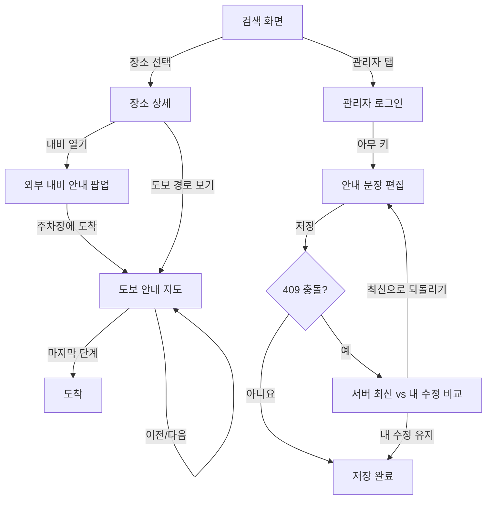
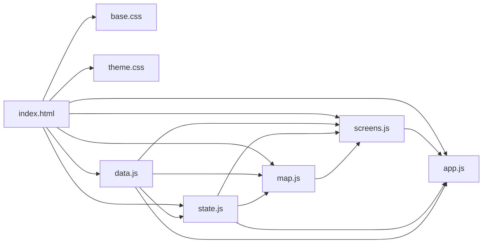
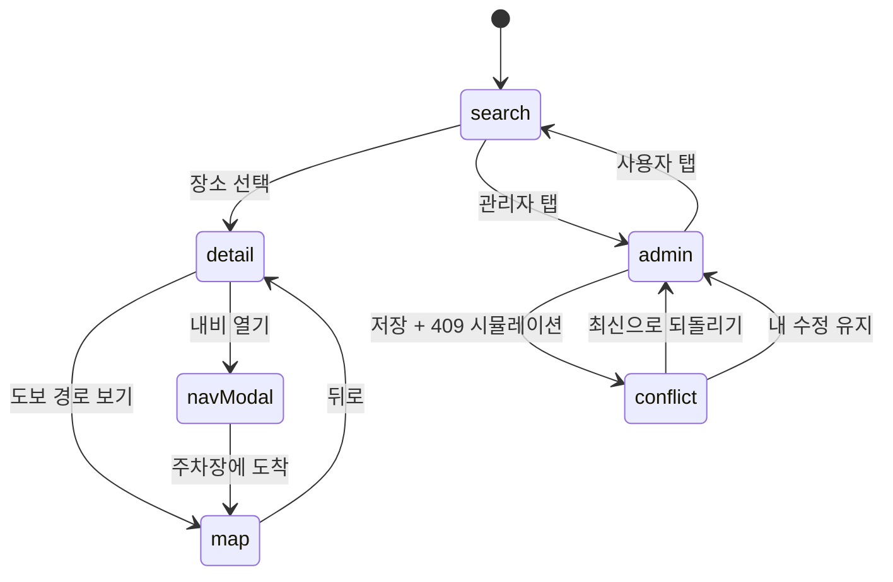

# 마지막 도보 구간 안내 프로토타입 해설 가이드

> 이 문서는 **「마지막 도보 구간 안내」 프로토타입**을 직접 읽고, 같은 동작을 공동 저장소의 뼈대에 옮길 수 있도록 정리한 해설서예요.
>
> 프로토타입 파일 자체는 이 저장소에 올리지 않습니다. 화면과 흐름을 빠르게 확인하려고 만든 **스케치**이기 때문이에요. 대신 “왜 이렇게 만들었는지”, “실제 저장소에서는 무엇이 달라지는지”를 이 문서에 최대한 자세히 적어 두었습니다.
>
> 이 문서는 **학습과 소통용**입니다. 실제 구현의 기준은 아래 세 가지예요.
>
> 1. `frontend/프론트_작성_가이드.md`
> 2. API 명세서 v1.3
> 3. `docs/screens/` 화면 캡처
>
> 셋과 이 문서가 충돌하면 **위 세 가지가 우선**입니다. 프로토타입은 어디까지나 “이런 느낌으로 만들면 좋겠다”를 보여 주는 참고 자료예요.
>
> **더 쉬운 버전:** 코드를 한 줄씩 따라 하면서 익히고 싶다면 [`프로토타입_따라하기_가이드.md`](프로토타입_따라하기_가이드.md)를 먼저 읽어 주세요. 이 문서는 그다음에 더 깊게 볼 때 보는 참고서입니다.

---

## 목차

| 장 | 내용 |
|---|---|
| 1 | 이 문서를 읽는 방법 |
| 2 | 프로토타입 한눈에 보기 |
| 3 | 실행 방법과 첫 점검 |
| 4 | 파일 8개의 역할 |
| 5 | 가장 중요한 원리: 상태(S) → render() |
| 6 | HTML 자세히 읽기 |
| 7 | CSS 자세히 읽기 |
| 8 | JavaScript 기초: 프로토타입에 나온 문법만 |
| 9 | `data.js`: 샘플 데이터 |
| 10 | `state.js`: 앱의 기억 장치 |
| 11 | `map.js`: SVG 2.5D 지도 |
| 12 | `screens.js`: 화면별 HTML 만들기 |
| 13 | `app.js`: 이벤트와 앱 시작 |
| 14 | 화면별 흐름 한 번에 따라가기 |
| 15 | 접근성과 모바일 UX |
| 16 | 공동 저장소의 실제 구조로 옮기기 |
| 17 | 추천 구현 순서와 연습 문제 |
| 18 | 자주 막히는 부분과 디버깅 |
| 19 | 초보자를 위한 용어 사전 |
| 20 | PR 전 체크리스트 |

---

## 1. 이 문서를 읽는 방법

이 문서는 **HTML, CSS, JavaScript를 각각 어느 정도는 봤지만, 하나의 앱이 어떻게 맞물려 돌아가는지는 아직 낯선 분**을 기준으로 썼어요.

처음부터 끝까지 한 번에 이해하려고 하지 않아도 됩니다. 추천하는 순서는 이래요.

1. **2~5장**을 먼저 읽으면서 “이 앱은 상태를 바꾸고 화면을 다시 그리는구나”를 잡습니다.
2. **6~8장**에서 HTML, CSS, JavaScript의 기본기를 프로토타입 코드와 함께 봅니다.
3. **9~13장**에서 파일 하나씩 뜯어봅니다.
4. **14~15장**에서 사용자 흐름과 접근성을 확인합니다.
5. **16~17장**에서 실제 저장소에 옮기는 방법을 봅니다.
6. **18~20장**은 구현하다 막힐 때 다시 찾아봅니다.

한 가지 당부하고 싶은 게 있어요. **코드를 눈으로만 읽지 말고, 꼭 브라우저에서 직접 눌러 보세요.** 프론트엔드는 “읽어서 아는 것”보다 “눌러 보고 확인하는 것”이 훨씬 중요합니다.

---

## 2. 프로토타입 한눈에 보기

이 프로토타입은 한 문장으로 이렇게 설명할 수 있어요.

> **주차장에 도착한 사용자가 목적 건물 입구까지 걸어가는 마지막 구간을, 단계별 문장과 2.5D 지도로 안내하는 모바일 화면**

실제 서비스의 전체 흐름은 아래와 같습니다.



### 화면은 네 개, 팝업은 두 개

| 구분 | 이름 | 사용자가 하는 일 |
|---|---|---|
| 화면 1 | 검색 | 장소 이름을 입력하고 목록에서 고릅니다 |
| 화면 2 | 장소 상세 | 주소와 시설을 보고, 내비 또는 도보 안내를 시작합니다 |
| 화면 3 | 도보 안내 지도 | 2.5D 지도와 단계 문장을 보며 이동합니다 |
| 화면 4 | 관리자 | 안내 문장을 수정하고 저장합니다 |
| 팝업 1 | 내비 안내 | 외부 내비 앱 연결이 아직 미정임을 알리고, “주차장에 도착했어요”를 누르게 합니다 |
| 팝업 2 | 409 충돌 | 다른 관리자가 먼저 수정한 경우, 서버 최신과 내 수정을 비교합니다 |

### 프로토타입이 일부러 하지 않은 것

처음 보는 사람이 가장 많이 오해하는 부분이라 먼저 적어 둘게요.

| 하지 않은 것 | 이유 |
|---|---|
| 실제 서버 API 호출 | 화면과 상태 흐름만 빠르게 확인하려고 샘플 데이터를 코드에 직접 넣었습니다 |
| 실제 지도(MapLibre) 사용 | 설치와 좌표 데이터 없이도 지도 느낌을 보여 주려고 SVG로 2.5D를 흉내 냈습니다 |
| 실제 관리자 인증 | 데모이므로 아무 키나 통과합니다 |
| 실제 위치 권한 요청 | 브라우저 권한, HTTPS, 실내 GPS 문제를 피하려고 “도착했어요” 버튼으로 대체했습니다 |
| URL 라우팅 | 새로고침하면 상태가 초기화됩니다. 실제 저장소에서는 화면마다 HTML과 URL이 따로 있습니다 |
| 프레임워크 사용 | 상태 → 렌더 원리를 직접 느껴 보라고 순수 HTML/CSS/JS로 만들었습니다 |

> **중요:** 프로토타입에서 “되지 않는 것”은 대부분 버그가 아니라 **의도적으로 뺀 것**입니다. 실제 구현에서는 `프론트_작성_가이드.md`의 TODO를 따라 하나씩 채우면 됩니다.

---

## 3. 실행 방법과 첫 점검

### 3.1 실행

1. `index.html`, `base.css`, `theme.css`, `data.js`, `state.js`, `map.js`, `screens.js`, `app.js`를 **같은 폴더 한 곳**에 둡니다.
2. `index.html`을 브라우저로 엽니다.
3. 서버 설치는 필요 없습니다.

프로토타입은 `file://`로 열어도 동작합니다. 외부 API를 부르지 않고, ES 모듈도 쓰지 않기 때문이에요. **실제 저장소는 반대**입니다. ES 모듈과 API를 쓰기 때문에 `file://`로 열면 안 되고, 반드시 `http://localhost:8000`으로 열어야 합니다.

### 3.2 처음 열었을 때 확인할 것

- [ ] 검색창에 “공학”을 입력하면 “공학관 (샘플)”이 나온다.
- [ ] 장소를 누르면 상세 화면으로 간다.
- [ ] “주차장으로 내비 열기”를 누르면 팝업이 뜬다.
- [ ] “주차장에 도착했어요”를 누르면 지도 화면으로 간다.
- [ ] “다음”을 누르면 지도 위 현재 위치 점과 단계 문장이 바뀐다.
- [ ] 아래 “관리자” 탭을 누르고 아무 키나 입력하면 편집 화면이 나온다.
- [ ] “저장 시 409 충돌 시뮬레이션”을 체크하고 저장하면 비교 팝업이 뜬다.

### 3.3 화면이 하얗게 나올 때

`index.html` 맨 아래에 이런 안전장치가 있습니다.

```html
<script>
if (typeof render !== "function") {
  document.getElementById("app").innerHTML =
    '<p style="padding:16px;font-family:sans-serif">파일을 불러오지 못했어요.<br>...</p>'
}
</script>
```

이 문구가 보이면 십중팔구 **파일이 빠졌거나, 폴더가 다르거나, 스크립트 순서가 잘못된 것**입니다. 브라우저 개발자 도구(F12)의 Console 탭을 열면 어떤 파일에서 오류가 났는지 정확히 나옵니다.

### 3.4 개발자 도구에서 꼭 해 볼 것

| 도구 | 하는 일 | 이 프로토타입에서 볼 것 |
|---|---|---|
| Elements | HTML 구조 보기 | `#app` 안이 `render()` 때마다 통째로 바뀌는지 |
| Console | 오류와 로그 보기 | 파일 순서가 틀리면 나오는 오류 |
| Network | 파일 요청 보기 | 8개 파일이 모두 200으로 불러와지는지 |
| Device Toolbar | 휴대폰 폭 보기 | 360px에서 가로 스크롤이 없는지 |
| Application | 저장소, 서비스 워커 | 프로토타입에는 아직 없음. 웹앱 전환 때 사용 |

---

## 4. 파일 8개의 역할

프로토타입은 파일을 역할별로 나눠 두었습니다. **불러오는 순서가 곧 의존 순서**예요.



| 파일 | 한 줄 설명 | 누가 사용하나 |
|---|---|---|
| `index.html` | 페이지 뼈대. CSS/JS를 불러오고 `#app` 상자를 만듭니다 | 브라우저 |
| `base.css` | 기본 디자인. 색 변수, 레이아웃, 버튼, 지도, 팝업 | 모든 화면 |
| `theme.css` | 디자인 덮어쓰기. 등산로 안내판/종이 지도 느낌 | 모든 화면 |
| `data.js` | 장소, 건물, 주차장, 경로, 안내 문장 샘플 | `state.js`, `map.js`, `screens.js`, `app.js` |
| `state.js` | 앱의 현재 상태 `S`와 디바운스 타이머 `t` | 모든 JS |
| `map.js` | 2.5D SVG 지도를 만드는 함수 | `screens.js` |
| `screens.js` | 화면별 HTML 문자열을 만드는 함수 | `app.js` |
| `app.js` | `render()`, 클릭/입력 처리, 앱 시작 | 브라우저 |

### 왜 이렇게 나눴나요?

한 파일에 500줄씩 들어 있으면 “검색 화면을 고치고 싶은데 어디를 봐야 하지?”가 됩니다. 역할별로 나누면 **고칠 곳을 빨리 찾을 수 있고, 오류가 났을 때 범위를 좁힐 수 있어요.**

다만 이 프로토타입은 **클래식 스크립트**라서 파일끼리 전역 변수를 공유합니다. 실제 저장소는 **ES 모듈**을 쓰기 때문에 `import`/`export`로 명시적으로 가져와야 합니다. 이 차이는 16장에서 자세히 다룹니다.

---

## 5. 가장 중요한 원리: 상태(S) → render()

이 앱의 심장은 딱 한 줄입니다.

> **상태(S)를 바꾸고 → `render()`로 화면을 통째로 다시 그린다.**

### 5.1 비유

- **상태(S)**는 앱의 “기억”입니다. 지금 어느 화면인지, 검색어가 무엇인지, 몇 번째 단계인지 기억합니다.
- **`render()`**는 그 기억을 보고 그림을 다시 그리는 “화가”입니다.
- 사용자가 버튼을 누르면 화가에게 직접 “이 글자를 바꿔”라고 하지 않습니다. **기억을 먼저 바꾸고, 화가를 부릅니다.**

```js
// 1) 사용자가 버튼을 누른다
S.step = S.step + 1

// 2) 화면을 다시 그린다
render()
```

### 5.2 코드로 보기

`app.js`의 `render()`는 이렇게 생겼습니다.

```js
function render() {
  // S.screen 값에 맞는 화면 함수를 골라 실행한다
  const v = { search, detail, map, admin }[S.screen]()

  // 공통 배너, 하단 탭, 팝업을 붙여서 #app에 통째로 넣는다
  document.getElementById("app").innerHTML = `
    <div class="banner">프로토타입 초안 · 샘플 데이터 · 와이어프레임 미확정</div>
    <main>${v}</main>
    <nav>...</nav>
    ${modal()}
  `
}
```

여기서 `{ search, detail, map, admin }[S.screen]`는 “이름표를 보고 함수를 고르는” 문법입니다. `if (S.screen === "search") ... else if ...`를 길게 쓰지 않아도 돼요.

### 5.3 상태가 바뀌는 흐름



### 5.4 이 방식의 장점과 주의점

| 장점 | 주의점 |
|---|---|
| 화면이 항상 S 하나를 보고 그려져서 예측 가능하다 | 화면을 통째로 다시 그리면 입력창의 커서와 포커스가 사라질 수 있다 |
| 디버깅할 때 S만 보면 현재 상태를 알 수 있다 | 스크롤 위치가 초기화될 수 있다 |
| “왜 이 화면이 이렇게 보이지?”를 S 값으로 설명할 수 있다 | 큰 앱에서는 다시 그리는 범위를 줄이는 최적화가 필요하다 |

프로토타입은 이 문제를 두 가지 방법으로 해결합니다.

1. **검색 입력**: `render()` 전에 커서 위치를 저장하고, 그린 뒤 다시 포커스를 준다.
2. **관리자 문장 입력**: `render()`를 부르지 않고, 글자 수 표시만 직접 바꾼다.

이 두 부분은 13장에서 자세히 설명합니다. 실제 저장소에서는 화면 전체를 다시 그리지 않고, 필요한 부분만 바꾸는 경우가 많아요. 하지만 **“상태가 먼저, 화면이 나중”**이라는 원리는 똑같습니다.

---

## 6. HTML 자세히 읽기

HTML은 “화면의 뼈대”입니다. 이 프로토타입의 HTML은 아주 짧아요. **내용은 JavaScript가 만들고, HTML은 상자와 파일 연결만 담당**합니다.

### 6.1 문서 선언과 언어

```html
<!DOCTYPE html>
<html lang="ko">
```

- `<!DOCTYPE html>`: “이 문서는 최신 HTML5 문서다”라고 브라우저에 알려 줍니다. 이게 없으면 브라우저가 예전 방식(quirks mode)으로 그려서 CSS가 예상과 다르게 동작할 수 있어요.
- `lang="ko"`: 한국어 문서라고 알려 줍니다. 스크린리더가 한국어로 읽고, 브라우저가 번역 여부를 판단할 때도 사용합니다.

### 6.2 문자 인코딩

```html
<meta charset="utf-8">
```

한글이 깨지지 않게 하는 가장 기본적인 설정입니다. **한글이 있는 HTML에는 반드시 넣어야 합니다.**

### 6.3 모바일 화면 설정

```html
<meta name="viewport" content="width=device-width, initial-scale=1, viewport-fit=cover">
```

- `width=device-width`: 화면 폭을 기기의 실제 폭으로 맞춥니다.
- `initial-scale=1`: 처음 확대 배율을 100%로 합니다.
- `viewport-fit=cover`: 아이폰 노치까지 화면 영역으로 사용합니다. 이 값을 쓰면 CSS의 `env(safe-area-inset-*)`가 의미를 가져요.

이 줄이 없으면 휴대폰에서 PC 화면처럼 아주 작게 보입니다. 모바일 웹을 만든다면 **거의 필수**입니다.

### 6.4 CSS 불러오기 순서

```html
<link rel="stylesheet" href="base.css">
<link rel="stylesheet" href="theme.css">
```

CSS는 **나중에 불러온 규칙이 같은 우선순위에서 이깁니다.** 그래서 `base.css`(기본) 다음에 `theme.css`(덮어쓰기)를 둡니다.

만약 순서를 바꾸면 테마 색과 글꼴이 기본 디자인에 다시 덮여서 “왜 테마가 안 먹지?”가 됩니다. **CSS 순서도 코드입니다.**

### 6.5 구글 폰트

```html
<link rel="preconnect" href="https://fonts.googleapis.com">
<link rel="preconnect" href="https://fonts.gstatic.com" crossorigin>
<link rel="stylesheet" href="https://fonts.googleapis.com/css2?family=Do+Hyeon&family=IBM+Plex+Sans+KR:wght@400;600&display=swap">
```

- `preconnect`: “곧 이 서버에서 폰트를 받을 거예요”라고 미리 연결해 두어 조금 빨라집니다.
- `display=swap`: 폰트를 받는 동안에도 일단 대체 글꼴로 글자를 보여 줍니다. 폰트가 늦게 와도 화면이 비지 않아요.
- 폰트를 못 받아도 `font-family`의 뒤쪽 대체 글꼴로 표시되므로 앱이 깨지지 않습니다.

> 실제 저장소는 CSP 때문에 외부 주소를 함부로 추가하면 안 됩니다. 구글 폰트는 이미 허용되어 있지만, 새 외부 폰트나 CDN을 추가하려면 `backend/app/frontend.py`의 CSP도 같이 봐야 해요.

### 6.6 화면이 그려질 상자

```html
<body>
  <div id="app"></div>
  ...
</body>
```

`#app`은 **JavaScript가 화면을 채워 넣는 빈 상자**입니다. HTML에는 검색창도, 지도도, 버튼도 없죠. 전부 `render()`가 만듭니다.

이 방식은 HTML이 단순해지지만, **JavaScript가 없으면 아무것도 안 보인다**는 단점이 있습니다. 실제 서비스에서는 검색 엔진, 초기 로딩, 장애 대응을 위해 중요한 내용은 HTML에도 두는 경우가 많아요. 이 프로토타입은 학습용이라 JS 렌더링에 집중했습니다.

### 6.7 스크립트 순서

```html
<script src="data.js"></script>
<script src="state.js"></script>
<script src="map.js"></script>
<script src="screens.js"></script>
<script src="app.js"></script>
```

스크립트는 **위에서 아래로** 실행됩니다. 뒤 파일이 앞 파일의 변수를 사용하므로 순서를 바꾸면 오류가 납니다.

| 순서 | 파일 | 이유 |
|---|---|---|
| 1 | `data.js` | `PLACES`, `steps` 같은 데이터를 먼저 만든다 |
| 2 | `state.js` | `S`를 만든다 |
| 3 | `map.js` | 지도 함수를 정의한다 |
| 4 | `screens.js` | 화면 함수를 정의한다 (`map.js` 사용) |
| 5 | `app.js` | 모든 것을 사용하고, 마지막에 `render()`를 호출한다 |

### 6.8 파일 연결 점검

```html
<script>
if (typeof render !== "function") {
  document.getElementById("app").innerHTML = "..."
}
</script>
```

클래식 스크립트에서 `function render() {}`는 전역 함수가 됩니다. 그래서 `typeof render`로 파일이 제대로 불러와졌는지 확인할 수 있어요.

실제 저장소는 ES 모듈이라 전역 함수를 이렇게 검사하지 않습니다. 대신 `import`가 실패하면 브라우저 콘솔에 모듈 오류가 납니다. **“빈 화면 = 파일 순서/경로 문제”**라는 감각은 둘 다 똑같아요.

### 6.9 HTML에서 기억할 것

- HTML은 **구조와 연결**을 담당한다.
- `lang`, `charset`, `viewport`는 기본 중의 기본이다.
- CSS와 JS는 **순서**가 중요하다.
- `#app`처럼 JavaScript가 채울 상자를 둘 수 있다.
- 접근성 속성(`aria-*`, `role`)은 HTML에 직접 적는다.

---

## 7. CSS 자세히 읽기

CSS는 “디자인 규칙”입니다. 이 프로토타입은 `base.css`와 `theme.css` 두 파일로 나눠서 **기본 구조와 테마를 분리**했습니다.

### 7.1 CSS 변수

```css
:root {
  --bg: #f4f5f7;
  --card: #fff;
  --ink: #1c2128;
  --target: #2563eb;
  --route: #0f766e;
}

body {
  background: var(--bg);
  color: var(--ink);
}
```

- `:root`는 문서의 최상위 요소(`html`)입니다.
- `--이름: 값`으로 변수를 만들고, `var(--이름)`으로 꺼내 씁니다.
- 색을 한곳에서 바꾸면 전체에 반영되므로 유지보수가 쉽습니다.

이 프로토타입의 주요 변수는 아래와 같아요.

| 변수 | 의미 | 사용처 |
|---|---|---|
| `--bg` | 배경 | `body` |
| `--card` | 카드/입력창 배경 | `.card`, `input`, `button` |
| `--ink` | 기본 글자 | `body` |
| `--sub` | 보조 글자 | `.sub` |
| `--line` | 테두리/구분선 | `.card`, `nav` |
| `--target` | 목적 건물/주요 버튼 | 건물, `.primary` |
| `--ent` | 입구 | 입구 마커 |
| `--park` | 주차장 | 주차장 마커 |
| `--route` | 도보 경로 | 경로 선, 진행 막대 |
| `--bld` | 일반 건물 | 건물 |
| `--ground` | 지도 바닥 | `theme.css`에서 추가 |

### 7.2 CSS 캐스케이드

CSS는 “폭포”라는 뜻이에요. 같은 요소에 여러 규칙이 있으면 **더 구체적인 선택자**, **더 나중에 선언된 규칙**이 이깁니다.

```css
/* base.css */
button { background: var(--card); }

/* theme.css — 나중에 불러오므로 이긴다 */
button.primary { background: var(--target); }
```

`button.primary`는 `button`보다 선택자가 구체적이라서, 순서와 상관없이 이깁니다. 하지만 같은 구체성이라면 나중 것이 이겨요. **`theme.css`를 `base.css` 뒤에 두는 이유**가 여기 있습니다.

### 7.3 다크 모드

```css
@media (prefers-color-scheme: dark) {
  :root:not([data-theme="light"]) {
    --bg: #14171c;
    --card: #1d2128;
    --ink: #eceff3;
    /* ... */
  }
}
```

- 사용자가 운영체제에서 다크 모드를 켜면 자동으로 색이 바뀝니다.
- `:not([data-theme="light"])`는 “라이트 모드로 강제한 경우가 아니면”이라는 뜻입니다. 나중에 수동 테마 전환을 넣을 때를 대비한 여지예요.
- 색을 변수로만 쓰면 다크 모드에서 **한곳만 고쳐도 전체가 맞습니다.**

실제 저장소의 `css/style.css`도 같은 방식으로 `--bg`, `--surface`, `--fg`, `--accent` 등을 라이트/다크에 각각 정의합니다.

### 7.4 `box-sizing`

```css
:root { box-sizing: border-box; }
*, *::before, *::after { box-sizing: inherit; }
```

`border-box`는 **width 안에 padding과 border를 포함해서 계산**하라는 뜻입니다.

```css
/* border-box가 없으면 */
.box { width: 100%; padding: 16px; } /* 실제 폭 = 100% + 32px → 가로 스크롤 */

/* border-box가 있으면 */
.box { width: 100%; padding: 16px; } /* 실제 폭 = 100% */
```

모바일에서 가로 스크롤이 생기는 가장 흔한 원인 중 하나예요. **전역으로 `border-box`를 거는 습관**을 들이면 좋습니다.

### 7.5 모바일 우선 레이아웃

```css
#app {
  max-width: 480px;
  margin: 0 auto;
  min-height: 100%;
  display: flex;
  flex-direction: column;
}

main { flex: 1; padding: 16px; }
```

- `max-width: 480px`: 휴대폰 폭으로 제한합니다.
- `margin: 0 auto`: 넓은 화면에서 가운데 정렬합니다.
- `display: flex; flex-direction: column`: 배너 → 본문 → 하단 탭 순서로 세로 배치합니다.
- `main { flex: 1 }`: 본문이 남는 공간을 모두 차지해서 하단 탭이 항상 아래에 붙습니다.

이 패턴은 실제 저장소의 `.app`에도 거의 그대로 있습니다.

### 7.6 안전 영역(노치)

```css
:root {
  padding-top: env(safe-area-inset-top, 0px);
  padding-bottom: env(safe-area-inset-bottom, 0px);
}
```

아이폰의 노치나 홈 인디케이터에 내용이 가리지 않도록 여백을 줍니다. `env()`의 두 번째 값은 “해당 값이 없을 때 쓸 기본값”입니다.

> 실제 저장소는 이 여백을 `:root`가 아니라 `.app`에 줍니다. 화면 전체가 아니라 앱 컨테이너에 주는 편이 예측 가능하고, 배경색과 여백을 분리하기 쉽기 때문이에요.

### 7.7 터치 대상과 접근성

```css
button {
  min-height: 44px;
  cursor: pointer;
}

button:focus-visible,
input:focus-visible,
textarea:focus-visible {
  outline: 2px solid var(--target);
  outline-offset: 2px;
}
```

- `min-height: 44px`: 손가락으로 누르기 편한 최소 크기입니다. 모바일에서는 사실상 필수예요.
- `:focus-visible`: 키보드로 이동했을 때만 포커스 테두리를 보여 줍니다. 마우스로 클릭할 때는 안 보여서 디자인이 지저분해지지 않아요.
- **`outline: none`으로 포커스 표시를 지우면 안 됩니다.** 키보드 사용자가 지금 어디에 있는지 알 수 없게 됩니다.

### 7.8 하단 탭 고정

```css
nav {
  display: flex;
  border-top: 1px solid var(--line);
  background: var(--card);
  position: sticky;
  bottom: 0;
}
```

`position: sticky; bottom: 0`은 스크롤해도 화면 아래에 붙어 있게 합니다. `fixed`보다 레이아웃에 자연스럽게 섞여요.

### 7.9 지도 전체 폭으로 늘리기

```css
svg.map {
  width: calc(100% + 32px);
  margin: 12px -16px 0;
  border: 0;
  border-radius: 0;
  background: var(--ground);
}
```

`main`의 좌우 padding이 16px이라서, 지도를 화면 끝까지 채우려면 **양쪽으로 16px씩 밀어내고(width +32px, margin -16px)** 늘립니다.

이런 “음수 margin”은 강력하지만, 부모의 padding이 바뀌면 같이 깨질 수 있어요. 실제 저장소에서는 지도 컨테이너를 `main` 바깥에 두거나, CSS Grid로 배치하는 편이 더 안전합니다.

### 7.10 팝업(모달)

```css
.modal {
  position: fixed;
  inset: 0;
  background: rgba(0, 0, 0, .45);
  display: flex;
  align-items: flex-end;
  justify-content: center;
  z-index: 5;
}

.modal > div {
  background: var(--card);
  width: 100%;
  max-width: 480px;
  padding: 16px;
  border-radius: 14px 14px 0 0;
}
```

- `position: fixed; inset: 0`: 화면 전체를 덮는 반투명 막을 만듭니다.
- `align-items: flex-end`: 안쪽 박스를 아래에 붙여서 **바텀시트**처럼 보이게 합니다.
- `z-index`: 다른 요소보다 위에 보이게 합니다.

프로토타입의 팝업은 포커스 트랩과 ESC 닫기가 없습니다. 실제 구현에서는 `role="dialog"`, `aria-modal="true"`, 열 때 포커스 이동, 닫을 때 원래 버튼으로 포커스 복귀, ESC 닫기를 꼭 넣어 주세요.

### 7.11 진행 막대

```css
.seg { display: flex; gap: 4px; }
.seg i { flex: 1; height: 6px; border-radius: 3px; background: var(--line); }
.seg i.on { background: var(--route); }
```

단계 수만큼 `<i>`를 만들고, 현재 단계까지 `.on`을 붙입니다. `flex: 1`이라서 칸 수가 늘어나도 자동으로 같은 폭을 나눠 가져요.

### 7.12 움직임 줄이기

```css
@media (prefers-reduced-motion: no-preference) {
  button { transition: background .15s; }
}
```

사용자가 “동작 줄이기”를 켜지 않았을 때만 전환 효과를 넣습니다. 접근성 배려이면서, 어지럼증을 유발하지 않도록 하는 기본입니다.

실제 저장소는 `prefers-reduced-motion: reduce`일 때 모든 애니메이션을 거의 0으로 줄이고, 지도 이동도 `flyTo` 대신 `jumpTo`를 씁니다.

### 7.13 CSS에서 기억할 것

- 색은 변수로 관리한다.
- `box-sizing: border-box`를 전역으로 건다.
- 모바일 우선, 최대 폭 480px.
- 터치 대상은 최소 44px.
- `:focus-visible`을 지우지 않는다.
- 다크 모드와 안전 영역을 처음부터 고려한다.
- 팝업은 `fixed + inset: 0`으로 만들 수 있지만, 접근성 처리가 더 필요하다.

---

## 8. JavaScript 기초: 프로토타입에 나온 문법만

JavaScript가 아직 비기너라고 하셨으니, 이 프로토타입에 **실제로 나온 문법만** 골라서 설명할게요. 이 정도만 이해하면 코드의 90%는 읽을 수 있습니다.

### 8.1 `const`와 `let`

```js
const PLACES = [];   // 다시 대입할 수 없음
let steps = [];      // 다시 대입할 수 있음 (내용 수정도 가능)
```

- `const`: 변수 자체를 다른 값으로 바꿀 수 없습니다. 하지만 배열/객체의 **내용**은 바꿀 수 있어요.
- `let`: 나중에 다른 값을 다시 대입할 수 있습니다.
- `var`는 예전 문법이라 이 프로토타입에서는 쓰지 않습니다.

`steps`가 `let`인 이유는 관리자 화면에서 `steps = [...S.draft]`처럼 **배열 자체를 새로 대입**하기 때문입니다.

### 8.2 배열과 객체

```js
const place = { id: 1, name: "공학관 (샘플)", route: true };
const places = [place, { id: 2, name: "학생회관 (샘플)", route: false }];

console.log(place.name);       // 공학관 (샘플)
console.log(places[0].id);     // 1
console.log(places.length);    // 2
```

- `{ }`는 객체(이름표가 붙은 묶음)입니다.
- `[ ]`는 배열(순서가 있는 목록)입니다.
- 점(`.`)으로 속성에 접근합니다.

### 8.3 함수

```js
// 함수 선언
function render() { ... }

// 화살표 함수
const esc = (s) => s.replace(...);
const P = (x, y, z = 0) => [ ... ];
```

- 함수는 “입력을 받아서 일을 하고 결과를 돌려주는 상자”입니다.
- `return`은 결과를 돌려줍니다.
- `z = 0`은 **기본값**입니다. 높이를 넘기지 않으면 0으로 계산합니다.

### 8.4 템플릿 문자열

```js
const name = "공학관";
const html = `<h1>${name}</h1>`;
```

백틱(`` ` ``)으로 감싸고 `${...}` 안에 변수나 계산식을 넣습니다. HTML 문자열을 조립할 때 아주 편해요.

### 8.5 `map`, `filter`, `find`

```js
// filter: 조건에 맞는 것만 남긴다
const list = PLACES.filter((p) => p.name.includes("공학"));

// map: 각 항목을 다른 값으로 바꾼다
const names = PLACES.map((p) => p.name);

// find: 조건에 맞는 첫 번째 항목을 찾는다
const place = PLACES.find((p) => p.id == id);
```

| 메서드 | 결과 | 예 |
|---|---|---|
| `filter` | 새 배열 | 검색 결과 |
| `map` | 새 배열(길이 같음) | 목록 HTML |
| `find` | 첫 번째 항목 또는 `undefined` | 장소 선택 |

### 8.6 구조 분해

```js
const [x0, y0, x1, y1] = b;       // 배열을 변수 4개로 풀기
const { screen, step } = S;        // 객체에서 필요한 값만 꺼내기
```

코드가 짧아지고, “이 배열은 네 개짜리구나”가 한눈에 보입니다.

### 8.7 스프레드

```js
const copy = [...steps];           // 배열 복사
const all = [...BUILDINGS];        // 원본을 건드리지 않고 복사
```

`[...steps]`는 **새 배열**을 만듭니다. 원본을 직접 바꾸지 않고 복사본을 만들어야 나중에 “내가 어디서 바꿨지?”를 추적하기 쉬워요.

### 8.8 삼항 연산자

```js
const label = last ? "도착" : "다음";
```

`조건 ? 참일 때 : 거짓일 때`입니다. 짧은 조건 분기에 유용하지만, 너무 중첩하면 읽기 어려워지니 주의하세요.

### 8.9 DOM 기본

```js
document.getElementById("app")          // id로 찾기
document.querySelector("main [aria-live]") // CSS 선택자로 찾기
element.innerHTML = "<p>...</p>"        // HTML 넣기
element.textContent = "글자"             // 글자만 넣기
element.dataset.act                     // data-act 값 읽기
element.classList.add("on")             // 클래스 추가
element.setAttribute("aria-current", "page")
element.focus()
element.setSelectionRange(pos, pos)     // 커서 위치 복원
```

| API | 특징 |
|---|---|
| `innerHTML` | HTML로 해석한다. **사용자 입력을 넣을 때는 반드시 escape** |
| `textContent` | 글자 그대로 넣는다. HTML이 실행되지 않아 안전 |
| `dataset` | `data-*` 속성을 읽고 쓴다 |
| `classList` | 클래스를 추가/삭제/토글한다 |

### 8.10 이벤트

```js
document.addEventListener("click", (e) => {
  const b = e.target.closest("[data-act]");
  if (!b) return;
  const a = b.dataset.act;
  // ...
});
```

- `addEventListener("click", 함수)`: 클릭이 일어날 때 함수를 실행합니다.
- `e.target`: 실제로 클릭된 요소입니다.
- `e.target.closest("[data-act]")`: 클릭된 요소에서 위로 올라가며 `data-act`가 있는 가장 가까운 부모를 찾습니다.
- 이렇게 하면 버튼 안의 `<b>`나 `<span>`을 눌러도 버튼 전체 클릭으로 처리됩니다.

### 8.11 이벤트 위임

버튼마다 클릭 코드를 붙이면, `render()`로 화면을 다시 그릴 때마다 이벤트가 사라집니다. 그래서 **문서 전체에서 클릭을 한 번만 받고**, 눌린 곳의 `data-act`를 보고 처리합니다. 이걸 **이벤트 위임(event delegation)** 이라고 해요.

```html
<button data-act="go" data-to="search">검색</button>
<button data-act="next">다음</button>
```

```js
const a = b.dataset.act; // "go" 또는 "next"
```

### 8.12 디바운스

```js
clearTimeout(t);
t = setTimeout(() => {
  // 300ms 뒤에 실행
}, 300);
```

- 타이핑할 때마다 검색하면 요청이 너무 많이 나갑니다.
- 입력이 **300ms 동안 멈췄을 때** 한 번만 실행하는 기법이 디바운스입니다.
- `clearTimeout(t)`은 이전 예약을 취소합니다. 글자를 계속 치면 계속 취소되고, 멈춘 순간 마지막 예약만 살아남아요.

### 8.13 XSS와 escape

```js
const esc = (s) =>
  s.replace(/[&<>"]/g, (c) => ({ "&": "&amp;", "<": "&lt;", ">": "&gt;", '"': "&quot;" }[c]));
```

사용자가 `<script>alert(1)</script>` 같은 글자를 검색창에 넣으면, 그대로 `innerHTML`에 들어갈 때 **스크립트가 실행될 수 있습니다.** 이걸 XSS(크로스 사이트 스크립팅)라고 해요.

그래서 사용자 입력을 HTML에 넣기 전에 `esc()`를 거칩니다. 실제 저장소의 `util.js`에는 작은따옴표까지 처리하는 `escapeHtml()`이 이미 있으니 **그 함수를 쓰면 됩니다.**

### 8.14 `aria-live`

```html
<div aria-live="polite">검색 결과...</div>
```

내용이 바뀌면 스크린리더가 읽어 줍니다. 검색 결과, 단계 안내 문장처럼 **동적으로 바뀌는 중요한 정보**에 붙입니다.

`polite`는 “지금 읽고 있는 것을 방해하지 않고, 끝나면 읽어 달라”는 뜻입니다. 긴급한 오류는 `assertive`를 쓸 수 있지만, 남용하면 사용자를 방해합니다.

### 8.15 JavaScript에서 기억할 것

- `const`/`let`을 먼저 구분한다.
- 배열 메서드 `map/filter/find`는 정말 자주 쓴다.
- 템플릿 문자열로 HTML을 조립한다.
- 이벤트는 `addEventListener`로 붙인다.
- `innerHTML`에 사용자 입력을 넣을 때는 escape한다.
- `S` 같은 상태 객체를 직접 바꾸고 `render()`를 부른다.

---

## 9. `data.js`: 샘플 데이터

`data.js`는 실제 API에서 내려올 값을 코드에 직접 적어 둔 파일입니다. **데이터의 모양**을 이해하는 게 중요해요.

### 9.1 장소 목록

```js
const PLACES = [
  { id: 1, name: "공학관 (샘플)", addr: "학교 내 시연 지역", route: true },
  { id: 2, name: "학생회관 (샘플)", addr: "학교 내 시연 지역", route: false },
  { id: 3, name: "체육관 (샘플)", addr: "학교 내 시연 지역", route: false }
];
```

| 필드 | 의미 |
|---|---|
| `id` | 장소 번호. 실제 API의 `place.id`에 해당 |
| `name` | 화면에 보이는 이름 |
| `addr` | 주소 |
| `route` | 도보 경로가 있는지 여부 (프로토타입 전용 플래그) |

`route: false`인 장소는 상세 화면에서 “도보 경로 보기” 버튼이 비활성화됩니다. 실제 API에서는 `walk-routes` 응답의 `items.length`로 판단합니다.

### 9.2 건물

```js
const BUILDINGS = [
  { n: "카페", b: [0, 2, 2, 4], f: 1 },
  { n: "도서관", b: [4, 6, 6, 8], f: 2 },
  { n: "공학관", b: [5, 1, 9, 4], f: 3, t: true }
];
```

| 필드 | 의미 |
|---|---|
| `n` | 건물 이름 |
| `b` | 바닥 사각형 `[x0, y0, x1, y1]` |
| `f` | 층수. 높이 = `f * 13px` |
| `t` | 목적 건물이면 `true` (강조색) |

좌표는 0~10 정도의 **가상 격자**입니다. 실제 위경도가 아니에요. 실제 저장소에서는 `buildings` GeoJSON의 `[경도, 위도]`와 `render_height_m`을 사용합니다.

### 9.3 주차장, 입구, 경로

```js
const PARK = { x: 1.5, y: 7.5, w: [0, 6, 3, 9] };
const ENT = { x: 7, y: 4 };
const ROUTE = [[1.5, 7.5], [3.5, 7.5], [3.5, 5], [7, 5], [7, 4]];
```

- `PARK`: 주차장 중심 좌표와 바닥 사각형
- `ENT`: 입구 좌표
- `ROUTE`: 도보 경로의 점 목록. 첫 점은 주차장, 마지막 점은 입구

경로는 **점을 순서대로 이은 선**입니다. 지도에서는 이 점들을 SVG `polyline`으로 연결해요.

### 9.4 안내 문장

```js
let steps = [
  "주차장 출구로 나와 도서관 쪽으로 걸어가세요.",
  "도서관 모서리에서 카페를 왼쪽에 두고 앞으로 가세요.",
  "공학관 앞 광장이 보이면 건물 쪽으로 오른쪽으로 도세요.",
  "공학관 입구에 도착했어요. 입구 문을 찾으세요."
];
```

`steps`가 `let`인 이유는 관리자 화면에서 문장을 수정하고 **배열 자체를 새로 대입**하기 때문입니다.

### 9.5 실제 API와의 차이

| 프로토타입 | 실제 저장소 |
|---|---|
| `PLACES` 배열 | `GET /api/v1/places?q=` 응답 `{ items, total }` |
| `BUILDINGS` 배열 | `GET /api/v1/places/{id}/buildings` GeoJSON |
| `PARK`, `ENT` | 장소 상세의 `parking_lots`, `entrances` |
| `ROUTE` | `walk-routes`의 `path.coordinates` |
| `steps` 문자열 배열 | `route.steps[]`의 `instruction`, `landmark`, `camera` 등 |
| 가상 좌표 0~10 | 실제 `[경도, 위도]` |

**프로토타입 데이터를 실제 API에 그대로 복사하면 안 됩니다.** 필드 이름과 좌표 체계가 다르기 때문이에요. 데이터를 옮길 때는 API 명세서의 응답 예시를 기준으로 맞춰 주세요.

---

## 10. `state.js`: 앱의 기억 장치

`state.js`는 앱의 현재 상태를 `S` 하나에 모아 둡니다.

```js
const S = {
  screen: "search",   // "search" | "detail" | "map" | "admin"
  q: "",              // 검색어
  loading: false,     // 검색 중인지
  place: null,        // 선택한 장소
  step: 0,            // 현재 단계 번호 (0부터)
  modal: null,        // null | "nav" | "conflict"
  authed: false,      // 관리자 로그인 여부
  draft: [],          // 관리자 수정 임시본
  conflict: false,    // 예비용 (현재 미사용)
  simConflict: false, // 409 시뮬레이션 체크박스
  saved: ""           // 저장 후 안내 문구
};
let t; // 디바운스 타이머
```

### 10.1 각 값이 화면에 미치는 영향

| 상태 | 값 | 화면 |
|---|---|---|
| `screen` | `"search"` | 검색 화면 |
| `screen` | `"detail"` | 장소 상세 |
| `screen` | `"map"` | 도보 안내 지도 |
| `screen` | `"admin"` | 관리자 |
| `q` | `"공학"` | 검색 결과 필터 |
| `loading` | `true` | “검색 중…” 표시 |
| `place` | 장소 객체 | 상세/지도 제목 |
| `step` | `0` | 첫 단계, 지도 현재 위치 |
| `modal` | `"nav"` | 내비 팝업 |
| `modal` | `"conflict"` | 409 비교 팝업 |
| `authed` | `true` | 관리자 편집 화면 |
| `draft` | 문자열 배열 | 편집 중인 문장 |
| `simConflict` | `true` | 저장 시 충돌 시뮬레이션 |
| `saved` | `"저장했어요"` | 저장 완료 문구 |

### 10.2 상태와 데이터의 차이

- **데이터(`data.js`)**: 앱이 가지는 고정된 재료. 장소 목록, 건물, 경로.
- **상태(`state.js`)**: 지금 이 사용자가 어디에 있고 무엇을 하고 있는지. 현재 화면, 검색어, 단계.

둘을 섞으면 “이 값은 서버에서 온 건가, 사용자가 만든 건가?”가 헷갈립니다. **재료는 data, 현재 상황은 state**로 나눠서 생각하세요.

### 10.3 파생 값은 상태에 넣지 않는다

```js
// 좋지 않은 예
S.isLastStep = S.step === steps.length - 1;

// 좋은 예: 필요할 때 계산한다
const last = S.step === steps.length - 1;
```

`isLastStep`처럼 다른 값으로 계산할 수 있는 것은 상태에 저장하지 않는 편이 좋습니다. 상태가 두 개가 되면 둘이 어긋날 수 있기 때문이에요.

### 10.4 실제 저장소에서는

실제 저장소는 화면마다 `state` 객체를 따로 둡니다.

```js
// guide.js
const state = {
  place: null,
  route: null,
  step: -1,
  error: ""
};
```

그리고 화면 이동은 URL로 합니다. `S.screen` 같은 전역 상태 대신 **주소가 상태의 일부**가 되는 거죠.

```
/                      → 검색
/place.html?id=1       → 장소 상세
/guide.html?id=1&...   → 도보 안내
/admin.html            → 관리자
```

이렇게 하면 새로고침해도 같은 화면이 나오고, 링크를 공유할 수 있고, 뒤로 가기가 자연스럽게 동작합니다.

---

## 11. `map.js`: SVG 2.5D 지도

이 파일이 아마 가장 낯설 거예요. 하지만 원리는 단순합니다.

> **평면 좌표 (x, y)를 비스듬히 내려다본 화면 좌표로 바꾸고, 건물을 세 면짜리 상자로 그린다.**

### 11.1 등각 투영(isometric)

```js
const U = 20;   // 격자 1칸 = 20px
const FH = 13;  // 건물 1층 높이 = 13px

const P = (x, y, z = 0) => [
  (180 + (x - y) * U * 0.866).toFixed(1),
  (30 + (x + y) * U * 0.5 - z).toFixed(1)
];
```

- `0.866`은 `cos(30°)`, `0.5`는 `sin(30°)`입니다.
- x가 커지면 오른쪽 아래로, y가 커지면 왼쪽 아래로 이동합니다.
- z(높이)는 화면의 y에서 빼서 위로 올립니다.
- `180`, `30`은 지도를 화면 안에 배치하기 위한 기준점입니다.
- `toFixed(1)`은 소수점 한 자리로 줄여 SVG 문자열이 너무 길어지지 않게 합니다.

#### 직접 계산해 보기

`P(0, 0)`은 `[180, 30]`입니다. `P(1, 0)`은 `[197.3, 40]`, `P(0, 1)`은 `[162.7, 40]`이에요. x축은 오른쪽 아래, y축은 왼쪽 아래로 뻗는 모습이 됩니다.

### 11.2 점 목록을 SVG 문자열로

```js
const pts = (a) => a.map((p) => p.join(",")).join(" ");
```

`[[10,20],[30,40]]`을 `"10,20 30,40"`으로 바꿉니다. SVG의 `points` 속성이 이 형식을 요구해요.

### 11.3 건물 상자 그리기

```js
function box(b, h, fill) {
  const [x0, y0, x1, y1] = b;
  return `
    <polygon points="${pts([P(x0,y1,0), P(x1,y1,0), P(x1,y1,h), P(x0,y1,h)])}" fill="${fill}" style="filter:brightness(.85)"/>
    <polygon points="${pts([P(x1,y0,0), P(x1,y1,0), P(x1,y1,h), P(x1,y0,h)])}" fill="${fill}" style="filter:brightness(.7)"/>
    <polygon points="${pts([P(x0,y0,h), P(x1,y0,h), P(x1,y1,h), P(x0,y1,h)])}" fill="${fill}"/>
  `;
}
```

건물 하나를 **왼쪽 면, 오른쪽 면, 윗면** 세 개의 `polygon`으로 그립니다.

| 면 | 밝기 | 이유 |
|---|---|---|
| 왼쪽 | 85% | 빛이 약간 덜 드는 느낌 |
| 오른쪽 | 70% | 가장 어둡게 해서 입체감 |
| 윗면 | 100% | 위에서 빛을 받는 느낌 |

색은 하나만 쓰고 `filter: brightness()`로 밝기만 바꿉니다. 색을 세 개 고르는 것보다 일관성 있게 보여요.

### 11.4 그리는 순서

```js
const bs = [...BUILDINGS]
  .sort((m, n) => (m.b[0] + m.b[1]) - (n.b[0] + n.b[1]))
  .map((o) => box(o.b, o.f * FH, o.t ? "var(--target)" : "var(--bld)"))
  .join("");
```

- `[...BUILDINGS]`로 원본을 복사합니다.
- `(x0 + y0)`가 작은 것부터 그립니다. 등각 투영에서 `x+y`가 작을수록 **뒤쪽(위쪽)** 이에요. 뒤에 있는 건물을 먼저 그려야 앞 건물이 자연스럽게 가립니다.
- 목적 건물(`t: true`)은 `--target`, 나머지는 `--bld` 색을 씁니다.

이렇게 “뒤에서 앞으로” 그리는 방법을 **화가의 알고리즘(painter's algorithm)** 이라고 합니다. 실제 3D 그래픽스에서도 깊이 정렬의 기본 개념이에요.

### 11.5 지도 전체 조립

```js
function mapSvg(i) {
  // i = 현재 단계 번호
  const [a, b, c, d] = PARK.w;
  const bs = ...;
  const all = pts(ROUTE.map((p) => P(p[0], p[1])));
  const done = pts(ROUTE.slice(0, i + 2).map((p) => P(p[0], p[1])));
  const cur = P(...ROUTE[Math.min(i + 1, ROUTE.length - 1)]);
  // ...
}
```

- `all`: 전체 경로 (연한 점선)
- `done`: 현재 단계까지 지나온 경로 (`slice(0, i+2)`)
- `cur`: 현재 위치 점
- `i + 2`인 이유: 0단계에서도 출발점과 첫 구간이 보이게 하려고
- `Math.min`으로 배열 범위를 넘지 않게 합니다

SVG는 **위에서 아래로** 그려지므로, 아래에 있는 요소가 위에 겹쳐 보입니다. 그래서 순서가 중요해요.

1. 주차장 바닥
2. 전체 경로 점선
3. 지나온 경로의 흰 테두리
4. 지나온 경로의 초록 선
5. 건물들
6. 주차장 마커
7. 입구 마커
8. 글자 라벨
9. 현재 위치 점

### 11.6 마커와 범례

주차장은 **파란 사각형 + P**, 입구는 **앰버색 마름모 + 문**입니다. 색만으로 구분하지 않고 모양도 다르게 해서, 색 구분이 어려운 사용자도 구별할 수 있게 했어요.

범례(`legend`)는 지도 아래에 같은 모양의 작은 아이콘과 설명을 보여 줍니다. **지도 기호를 처음 보는 사용자**를 위한 배려입니다.

### 11.7 SVG의 `viewBox`

```html
<svg class="map" viewBox="0 0 360 250" role="img" aria-label="2.5D 지도...">
```

`viewBox`는 “이 SVG 안의 좌표계는 0~360, 0~250이다”라고 알려 줍니다. CSS에서 `width: 100%; height: auto`를 주면 화면 폭에 맞춰 **비율을 유지한 채** 늘어나고 줄어들어요.

### 11.8 실제 저장소의 지도와 무엇이 다른가

| 프로토타입 | 실제 저장소 |
|---|---|
| SVG로 직접 그림 | MapLibre GL JS로 3D 지도 |
| 가상 격자 좌표 | 실제 `[경도, 위도]` |
| 고정된 카메라 | `flyTo({ center, bearing, pitch, zoom })` |
| 건물을 `polygon`으로 그림 | `fill-extrusion` 레이어 |
| 경로를 `polyline`으로 그림 | GeoJSON LineString 레이어 |
| 마커를 SVG로 그림 | `maplibregl.Marker` + DOM 요소 |
| 지도 라이브러리 없음 | `vendor/maplibre-gl-4.7.1/` |
| 오프라인 대체 지도 없음 | 저장해 둔 캠퍼스 지도로 전환 |

프로토타입의 SVG 지도는 **지도 라이브러리 없이도 “이런 느낌”을 보여 주는 용도**입니다. 실제 구현에서는 `js/map.js`의 `createMap`, `drawBuildings`, `drawRoute`, `drawMarkers`, `flyTo`를 사용하세요. 좌표 변환은 `js/geo.js`가 담당합니다.

### 11.9 연습

- `U`를 30으로 바꾸면 지도가 어떻게 변할까요?
- `FH`를 20으로 바꾸면 건물 높이가 어떻게 변할까요?
- `BUILDINGS`에 건물을 하나 추가해 보세요. 어떤 순서로 그려져야 자연스러울까요?
- `ROUTE`의 점 순서를 바꾸면 경로가 어떻게 보일까요?

---

## 12. `screens.js`: 화면별 HTML 만들기

`screens.js`의 각 함수는 **해당 화면의 HTML 문자열을 돌려줍니다.** React의 컴포넌트와 비슷한 역할이에요. 다만 React처럼 상태가 바뀌면 자동으로 다시 그리는 게 아니라, `app.js`의 `render()`가 직접 호출합니다.

### 12.1 `esc()`: XSS 방지

```js
const esc = (s) =>
  s.replace(/[&<>"]/g, (c) => ({ "&": "&amp;", "<": "&lt;", ">": "&gt;", '"': "&quot;" }[c]));
```

검색어, 관리자 문장처럼 **사용자가 입력한 값**을 HTML에 넣기 전에 반드시 거칩니다. 실제 저장소에서는 `escapeHtml()`을 쓰세요.

### 12.2 검색 화면 `search()`

```js
function search() {
  const list = PLACES.filter((p) => p.name.includes(S.q.trim()));
  let body = "";

  if (!S.q.trim()) body = `<p class="sub">검색어를 입력해 주세요. (예: 공학)</p>`;
  else if (S.loading) body = `<p>검색 중…</p>`;
  else if (!list.length) body = `<p>“${esc(S.q)}”에 대한 결과가 없어요.</p>`;
  else body = list.map((p) => `<button ...>...</button>`).join("");

  return `<h1>어디로 가세요?</h1>...`;
}
```

검색 화면은 **네 가지 상태**를 모두 처리합니다.

| 상태 | 조건 | 화면 |
|---|---|---|
| 입력 없음 | `!S.q.trim()` | “검색어를 입력해 주세요.” |
| 검색 중 | `S.loading` | “검색 중…” |
| 결과 없음 | `list.length === 0` | “결과가 없어요.” |
| 결과 있음 | 그 외 | 장소 목록 |

초보자가 자주 놓치는 것이 **결과 없음과 로딩 상태**예요. “결과가 없을 때”만 처리하고 “아직 입력하지 않았을 때”를 빼먹으면, 처음 화면에 “결과가 없어요”가 떠서 어색해집니다. **네 상태를 항상 같이 생각하세요.**

검색 결과 버튼에는 이런 데이터가 붙습니다.

```html
<button class="item" data-act="open" data-id="1">
  <b>공학관 (샘플)</b><br><span class="sub">학교 내 시연 지역</span>
</button>
```

`data-act="open"`은 “이 버튼을 누르면 장소를 연다”, `data-id`는 “어떤 장소인지”를 알려 줍니다. 클릭 처리는 `app.js`가 담당해요.

### 12.3 상세 화면 `detail()`

```js
function detail() {
  const p = S.place;
  return `
    <button data-act="go" data-to="search">← 검색으로</button>
    <h1>${p.name}</h1>
    <div class="card">...</div>
    ${p.route ? "" : `<div class="card" role="status">이 장소는 아직 도보 경로 안내가 준비되지 않았어요.</div>`}
    <div class="row">
      <button class="primary" data-act="nav">주차장으로 내비 열기</button>
      <button data-act="go" data-to="map" ${p.route ? "" : "disabled"}>도보 경로 보기</button>
    </div>
  `;
}
```

핵심은 **경로가 없을 때 이유를 보여 주는 것**입니다. 버튼만 흐리게 하고 끝내면 사용자는 “왜 안 눌리지?”라고 생각해요. `role="status"`가 붙은 안내 카드로 이유를 알려 줍니다.

실제 저장소의 `place.js`에는 `renderRouteState(routes)`가 이 역할을 합니다. 경로가 없으면 `#btn-guide`에 `aria-disabled="true"`를 주고, `#route-notice`를 보여 줍니다.

### 12.4 지도 화면 `map()`

```js
function map() {
  const last = S.step === steps.length - 1;
  return `
    <button data-act="go" data-to="detail">← 상세</button>
    <h1>${S.place.name}</h1>
    ${mapSvg(S.step)}${legend}
    <div class="sheet" aria-live="polite">
      <div class="seg" aria-hidden="true">
        ${steps.map((_, k) => `<i class="${k <= S.step ? "on" : ""}"></i>`).join("")}
      </div>
      <div class="num">${S.step + 1}<span class="sub"> / ${steps.length}</span></div>
      <div class="txt">${esc(steps[S.step])}</div>
      <div class="row">
        <button data-act="prev" ${S.step ? "" : "disabled"}>이전</button>
        <button class="primary" data-act="next" ${last ? "disabled" : ""}>${last ? "도착" : "다음"}</button>
      </div>
    </div>
  `;
}
```

- `S.step + 1`: 컴퓨터는 0부터 세지만 사람은 1부터 세니까 화면에는 +1 해서 보여 줍니다.
- `last`: 마지막 단계인지 여부.
- `disabled`: 첫 단계에서는 “이전”, 마지막 단계에서는 “다음”을 누를 수 없게 합니다.
- `aria-live="polite"`: 단계가 바뀌면 스크린리더가 새 문장을 읽어 줍니다.
- `aria-hidden="true"`: 진행 막대는 시각 정보라서 스크린리더에서 숨깁니다.

> **프로토타입의 한계:** 마지막 단계에서 “도착”을 눌러도 별도 도착 완료 화면으로 가지 않고 마지막 단계에 머뭅니다. 실제 저장소의 `guide.js`는 `step`이 `n`이 되면 “도착” 완료 화면을 보여 줍니다. 프로토타입은 흐름을 단순화한 것이에요.

### 12.5 관리자 화면 `admin()`

로그인 전:

```html
<h1>관리자</h1>
<input id="key" type="password" placeholder="관리자 키 (데모: 아무 값)">
<button class="primary" data-act="login">확인</button>
<p class="sub">실제 앱: X-Admin-Key 헤더, 키는 sessionStorage 보관</p>
```

로그인 후:

```js
if (!S.draft.length) S.draft = [...steps];
const rows = S.draft.map((v, i) => `
  <label class="sub" for="s${i}">단계 ${i + 1} <span id="c${i}">${v.length}/200</span></label>
  <textarea id="s${i}" data-i="${i}" rows="2" maxlength="200">${esc(v)}</textarea>
`).join("");
```

- 처음 들어오면 `draft`가 비어 있으므로 현재 `steps`를 복사해 채웁니다.
- `maxlength="200"`은 실제 API 규칙(1~200자)을 흉내 낸 것입니다.
- `data-i`는 “몇 번째 단계인지”를 나타냅니다.
- 글자 수 표시 `c0`, `c1`은 입력할 때마다 갱신됩니다.

### 12.6 팝업 `modal()`

```js
function modal() {
  if (S.modal === "nav") return `...`;
  if (S.modal === "conflict") return `...`;
  return "";
}
```

`S.modal`이 `null`이면 빈 문자열을 돌려주므로 아무것도 표시되지 않습니다.

#### 내비 팝업

외부 내비 앱 종류와 딥링크가 아직 미정이라 연결하지 않고, “이 프로토타입에서는 연결 없이 다음 단계로 넘어가요”라고 안내합니다. 그리고 “주차장에 도착했어요” 버튼으로 지도 화면에 진입합니다.

#### 409 충돌 팝업

```html
<div class="cmp">
  <div><b>서버 최신</b><br>...</div>
  <div><b>내 수정</b><br>...</div>
</div>
```

- 왼쪽: 서버 최신 문장
- 오른쪽: 내가 수정한 문장
- “최신으로 되돌리기”: 내 수정을 버리고 서버 최신을 `draft`에 복사
- “내 수정 유지·다시 저장”: 내 수정을 `steps`에 반영

**자동 재시도하지 않는 것**이 중요합니다. 409는 “누군가 먼저 수정했다”는 뜻이라서, 자동으로 덮어쓰면 다른 사람의 수정을 날릴 수 있어요. 사용자가 비교하고 선택하게 해야 합니다.

### 12.7 `screens.js`에서 기억할 것

- 각 함수는 HTML 문자열을 돌려주는 **작은 컴포넌트**다.
- 사용자 입력은 반드시 `esc()`를 거친다.
- 로딩/빈 값/결과 없음/결과 있음 **네 상태**를 같이 생각한다.
- 버튼이 비활성인 이유를 화면에 설명한다.
- `aria-live`, `role="status"`, `aria-hidden`을 상황에 맞게 쓴다.

---

## 13. `app.js`: 이벤트와 앱 시작

`app.js`는 세 가지를 합니다.

1. `render()`로 화면 그리기
2. 클릭/입력 이벤트 처리
3. 앱 시작

### 13.1 `render()`

```js
function render() {
  const v = { search, detail, map, admin }[S.screen]();
  const tab = S.screen === "admin" ? "admin" : "user";

  document.getElementById("app").innerHTML = `
    <div class="banner">프로토타입 초안 · 샘플 데이터 · 와이어프레임 미확정</div>
    <main>${v}</main>
    <nav>
      <button data-act="go" data-to="search" ${tab === "user" ? 'aria-current="page"' : ""}>사용자</button>
      <button data-act="go" data-to="admin" ${tab === "admin" ? 'aria-current="page"' : ""}>관리자</button>
    </nav>
    ${modal()}
  `;
}
```

- `S.screen`에 따라 화면 함수를 고릅니다.
- 공통 배너, 하단 탭, 팝업을 항상 함께 붙입니다.
- `aria-current="page"`로 현재 탭을 표시합니다.

### 13.2 클릭 이벤트 위임

```js
document.addEventListener("click", (e) => {
  const b = e.target.closest("[data-act]");
  if (!b) return;

  const a = b.dataset.act;

  if (a === "go") {
    S.screen = b.dataset.to;
  } else if (a === "open") {
    S.place = PLACES.find((p) => p.id == b.dataset.id);
    S.step = 0;
    S.screen = "detail";
  } else if (a === "nav") {
    S.modal = "nav";
  }
  // ...

  render();
});
```

동작별로 **상태만 바꾸고**, 마지막에 `render()`를 한 번 부릅니다. 이 패턴을 지키면 “클릭했는데 화면이 안 바뀐다”는 대부분 `render()` 호출을 빠뜨린 것입니다.

### 13.3 동작 목록

| `data-act` | 하는 일 | 바뀌는 상태 |
|---|---|---|
| `go` | 화면 이동 | `S.screen = data-to` |
| `open` | 장소 선택 후 상세로 | `S.place`, `S.step = 0`, `S.screen = "detail"` |
| `nav` | 내비 팝업 열기 | `S.modal = "nav"` |
| `close` | 팝업 닫기 | `S.modal = null` |
| `arrived` | 주차장 도착 → 지도 | `S.modal = null`, `S.step = 0`, `S.screen = "map"` |
| `next` | 다음 단계 | `S.step = Math.min(S.step + 1, steps.length - 1)` |
| `prev` | 이전 단계 | `S.step = Math.max(S.step - 1, 0)` |
| `login` | 관리자 로그인 | `S.authed = true` |
| `logout` | 로그아웃 | `S.authed = false`, `S.draft = []` |
| `save` | 저장 | `S.simConflict` 확인, `steps` 또는 `S.modal` 변경 |
| `useServer` | 서버 최신으로 | `S.draft = [...steps]`, `S.modal = null` |
| `force` | 내 수정 유지 | `steps = [...S.draft]`, `S.modal = null` |

### 13.4 저장과 409 시뮬레이션

```js
else if (a === "save") {
  S.simConflict = document.getElementById("sim").checked;

  if (S.simConflict) {
    steps = [...steps];
    steps[0] = "[다른 관리자가 수정한 문장] " + steps[0].replace(/^\[.*?\]\s*/, "");
    S.modal = "conflict";
  } else {
    steps = [...S.draft];
    S.saved = "저장했어요";
  }
}
```

- 체크박스가 켜져 있으면 **다른 관리자가 먼저 수정한 상황**을 흉내 냅니다.
- `steps[0]` 앞에 `[다른 관리자가 수정한 문장]`을 붙입니다.
- `replace(/^\[.*?\]\s*/, "")`는 이미 붙어 있는 꼬리표를 먼저 지워서, 여러 번 눌러도 중복되지 않게 합니다.
- 실제 서버에서는 이 상황이 **409 CONFLICT** 응답으로 옵니다.

### 13.5 검색 입력과 디바운스

```js
document.addEventListener("input", (e) => {
  if (e.target.id === "q") {
    S.q = e.target.value;
    S.loading = true;

    clearTimeout(t);
    t = setTimeout(() => {
      S.loading = false;

      const x = document.getElementById("q");
      const pos = x ? x.selectionStart : 0;

      render();

      const n = document.getElementById("q");
      if (n) {
        n.focus();
        n.setSelectionRange(pos, pos);
      }
    }, 300);

    // 타이핑하는 동안에는 결과 영역만 "검색 중…"으로 바꾼다
    const m = document.querySelector("main [aria-live]");
    if (m) m.innerHTML = S.q.trim() ? "<p>검색 중…</p>" : '<p class="sub">검색어를 입력해 주세요. (예: 공학)</p>';
  }
  // ...
});
```

여기서 중요한 포인트가 세 개 있어요.

1. **디바운스 300ms**: 글자를 칠 때마다 검색하지 않고, 멈춘 뒤 한 번만 검색합니다.
2. **포커스 복원**: `render()`로 화면을 다시 그리면 입력창이 새로 만들어져서 커서가 사라집니다. 그래서 그리기 전에 `selectionStart`를 저장하고, 그린 뒤 `focus()`와 `setSelectionRange()`로 복원합니다.
3. **부분 갱신**: 타이핑 중에는 전체를 다시 그리지 않고, `aria-live` 영역만 “검색 중…”으로 바꿉니다. 그래야 입력이 끊기지 않아요.

> 실제 저장소의 `home.js`는 `debounce()` 유틸을 쓰고, **늦게 도착한 옛 응답을 버리는 `seq`**도 있습니다. 네트워크 응답은 순서가 바뀔 수 있기 때문이에요. 프로토타입은 로컬 데이터라 동기적으로 끝나서 이 처리가 필요 없었습니다.

### 13.6 관리자 문장 입력

```js
else if (e.target.dataset.i !== undefined) {
  const i = +e.target.dataset.i;
  S.draft[i] = e.target.value;
  document.getElementById("c" + i).textContent = e.target.value.length + "/200";
  S.saved = "";
}
```

- `+e.target.dataset.i`: 문자열 `"0"`을 숫자 `0`으로 바꿉니다.
- `S.draft[i]`에 바로 반영합니다.
- 글자 수 표시만 직접 갱신합니다. **`render()`를 부르지 않는 이유**는 입력창이 새로 만들어져 커서가 튀기 때문입니다.
- 다시 수정했으므로 “저장했어요” 문구를 지웁니다.

### 13.7 앱 시작

```js
render();
```

파일 맨 마지막에서 한 번 호출합니다. 이 한 줄이 없으면 화면이 비어 있어요.

### 13.8 `app.js`에서 기억할 것

- 상태를 바꾸고 마지막에 `render()`를 한 번 부른다.
- 클릭은 문서 전체에서 위임받아 처리한다.
- 입력 중에는 전체 렌더를 피하거나 포커스를 복원한다.
- 409는 자동으로 덮어쓰지 않고 사용자에게 선택지를 준다.
- 앱 시작은 `render()` 한 번이다.

---

## 14. 화면별 흐름 한 번에 따라가기

### 14.1 사용자 흐름

| 단계 | 사용자 행동 | 상태 변화 | 화면 |
|---|---|---|---|
| 1 | 앱을 연다 | `S.screen = "search"` | 검색 |
| 2 | “공학” 입력 | `S.q = "공학"`, `S.loading = true` | “검색 중…” |
| 3 | 300ms 멈춤 | `S.loading = false` | “공학관 (샘플)” |
| 4 | 장소 클릭 | `S.place = 공학관`, `S.step = 0`, `S.screen = "detail"` | 상세 |
| 5 | “내비 열기” 클릭 | `S.modal = "nav"` | 내비 팝업 |
| 6 | “주차장에 도착” 클릭 | `S.modal = null`, `S.step = 0`, `S.screen = "map"` | 지도 1단계 |
| 7 | “다음” 클릭 | `S.step = 1` | 지도 2단계 |
| 8 | 마지막 단계 | `S.step = 3` | “도착” 버튼 |
| 9 | “도착” 클릭 | `S.step`은 그대로 (프로토타입 한계) | 마지막 단계 |

### 14.2 관리자 흐름

| 단계 | 사용자 행동 | 상태 변화 | 화면 |
|---|---|---|---|
| 1 | “관리자” 탭 | `S.screen = "admin"` | 키 입력 |
| 2 | 아무 키나 입력 후 확인 | `S.authed = true` | 편집 |
| 3 | 문장 수정 | `S.draft[i] = ...` | 글자 수 갱신 |
| 4 | 저장 | `S.simConflict` 확인 | 저장 완료 또는 충돌 팝업 |
| 5 | 충돌 팝업에서 “최신으로” | `S.draft = [...steps]` | 편집으로 복귀 |
| 6 | 충돌 팝업에서 “내 수정 유지” | `steps = [...S.draft]` | 저장 완료 |
| 7 | 로그아웃 | `S.authed = false`, `S.draft = []` | 키 입력 |

### 14.3 예외 상황

| 상황 | 프로토타입의 처리 | 실제 구현에서 보완할 것 |
|---|---|---|
| 검색 결과 없음 | “결과가 없어요” | 그대로 유지 |
| 검색어 없음 | “검색어를 입력해 주세요” | 첫 화면에서는 전체 목록을 보여 줄 수도 있음 |
| 경로 없는 장소 | “도보 경로 보기” 비활성 | 주차장별 경로 유무 표시 |
| 경로 없는 장소에서 내비 팝업 → 도착 | 지도 화면으로 진입 가능 (허점) | 경로가 없으면 지도 진입을 막고 안내 |
| 마지막 단계 | “도착” 버튼이지만 머무름 | 도착 완료 화면(`step = n`) |
| 409 | 비교 팝업 | `expected_updated_at`으로 실제 서버 충돌 처리 |
| 새로고침 | 상태 초기화 | URL + 서버 데이터로 복원 |
| 관리자 키 오류 | 아무 키나 통과 | 401, 429 잠금 처리 |

> **멘토링 포인트:** “경로 없는 장소에서 내비 팝업을 열 수 있는데, 도착을 누르면 지도로 갈 수 있네요?”라는 질문이 나오면 아주 좋은 질문입니다. 프로토타입의 허점을 발견한 거예요. 실제 구현에서는 `place.route` 또는 `routes.length`를 확인해서 막아야 합니다.

### 14.4 새로고침하면 왜 처음으로 돌아가나요?

프로토타입은 상태를 메모리에만 두기 때문입니다. `S`는 페이지를 새로고침하면 새로 만들어집니다. 실제 저장소는 **URL**과 **서버 데이터**로 화면을 복원합니다.

```
/place.html?id=1
/guide.html?id=1&parking_lot_id=2&start=1
/admin.html
```

이렇게 주소에 필요한 값을 넣으면 새로고침, 링크 공유, 뒤로 가기가 모두 자연스럽게 동작합니다.

---

## 15. 접근성과 모바일 UX

프로토타입에 이미 들어 있는 접근성 배려를 정리해 볼게요. 실제 구현에서도 그대로 가져가면 좋습니다.

| 항목 | 프로토타입 | 실제 저장소 |
|---|---|---|
| 터치 크기 | `button { min-height: 44px }` | `.btn` 44px, 아이콘 버튼 `.btn-icon` 44×44 |
| 키보드 포커스 | `:focus-visible` 외곽선 | 그대로 유지, `outline: none` 금지 |
| 현재 탭 | `aria-current="page"` | 그대로 |
| 동적 안내 | `aria-live="polite"` | 검색 결과, 단계 문장 |
| 팝업 | `role="dialog"`, `aria-modal="true"` | `#navi-sheet`, `#conflict-dialog` |
| 상태 안내 | `role="status"` | 경로 없음 안내 |
| 지도 | `role="img"`, `aria-label` | 지도 컨테이너 + 범례 |
| 색 구분 | 색 + 모양(사각형/마름모) | 마커 모양 + 범례 |
| 움직임 | `prefers-reduced-motion` | 지도 `flyTo` → `jumpTo` |
| 안전 영역 | `env(safe-area-inset-*)` | `.app` padding |
| 다크 모드 | `prefers-color-scheme` | `css/style.css` 토큰 |

### 15.1 팝업에서 보완할 것

프로토타입 팝업에는 아래가 빠져 있습니다. 실제 구현에서는 꼭 넣어 주세요.

- 열릴 때 팝업 안 첫 버튼으로 포커스 이동
- `Tab` 키가 팝업 밖으로 나가지 않게 하는 포커스 트랩
- `ESC` 키로 닫기
- 닫을 때 원래 버튼으로 포커스 복귀
- 바깥 막을 눌렀을 때 닫을지 결정 (실수 방지를 위해 안 닫는 것도 방법)

### 15.2 색만으로 구분하지 않기

주차장은 파란 사각형 + P, 입구는 앰버 마름모 + 문으로 **모양도 다르게** 했습니다. 색각 이상이 있는 사용자, 흑백 화면, 밝은 야외 화면에서도 구별할 수 있게 하기 위해서예요.

### 15.3 문구는 짧고 구체적으로

- “오류가 발생했습니다”보다 “서버에 연결하지 못했어요. 인터넷 연결을 확인해 주세요.”
- “불가”보다 “이 장소는 아직 도보 경로 안내가 준비되지 않았어요.”
- “다음”보다 마지막 단계에서는 “도착”

사용자는 시스템의 사정을 모릅니다. **무엇이 문제이고, 무엇을 하면 되는지**를 알려 주세요.

---

## 16. 공동 저장소의 실제 구조로 옮기기

여기서부터가 가장 중요합니다. 프로토타입은 **한 페이지에서 `S.screen`으로 화면을 바꾸는 구조**지만, 공동 저장소는 **화면마다 HTML과 JS 파일이 따로 있는 멀티 페이지 구조**입니다.

### 16.1 큰 그림

| 프로토타입 | 공동 저장소 |
|---|---|
| `index.html` 하나 | `index.html`, `place.html`, `guide.html`, `admin.html`, `404.html` |
| `app.js`의 `S.screen` 전환 | 실제 페이지 이동 + URL 쿼리 |
| `screens.js`의 화면 함수 | 각 페이지의 `js/pages/*.js` |
| `data.js` 샘플 데이터 | `js/api.js` + `mock/` + 실제 API |
| `state.js` 전역 `S` | 화면별 `state` 객체 + URL + 저장소 |
| `map.js` SVG | `js/map.js` MapLibre + `js/geo.js` |
| `base.css` + `theme.css` | `css/style.css` 하나 |
| 클래식 스크립트 | ES 모듈(`type="module"`) + `import`/`export` |
| `file://` 실행 | `http://localhost:8000` 실행 |
| 관리자 아무 키 | `X-Admin-Key`, 401/429 처리 |
| 409 시뮬레이션 | 실제 409 응답과 `expected_updated_at` |
| 도착 버튼 | `navigator.geolocation` + 거리 판정 + 대체 버튼 |

### 16.2 파일별 대응표

| 프로토타입 | 실제 파일 | 옮길 때 핵심 |
|---|---|---|
| `index.html` | `index.html`, `place.html`, `guide.html`, `admin.html` | 화면마다 HTML을 나눈다 |
| `state.js` | 각 페이지 `state` + `util.js`의 `param()` | 전역 S 대신 화면별 상태 |
| `data.js` | `js/api.js`, `mock/*.json` | 서버 응답 형식으로 바꾼다 |
| `map.js` | `js/map.js`, `js/geo.js` | SVG → MapLibre, 가상 좌표 → 경위도 |
| `screens.js` | `js/pages/home.js`, `place.js`, `guide.js`, `admin.js` | HTML 문자열 → DOM 조각/템플릿 |
| `app.js` `render()` | 각 페이지의 `render()` | 상태 → 화면 원리는 유지 |
| `app.js` 클릭 위임 | 각 페이지의 `bind()` + `addEventListener` | 페이지별 이벤트 |
| `base.css` + `theme.css` | `css/style.css` | 토큰과 공용 부품으로 통합 |
| 내비 팝업 | `place.html`의 `#navi-sheet`, `js/navi.js` | 딥링크, 여행 저장, 도착 판정 |
| 409 팝업 | `admin.html`의 `#conflict-dialog`, `api.js` | 실제 409, `updated_at` 문자열 |
| 관리자 로그인 | `admin.html`의 `#key-form`, `admin-store.js` | `sessionStorage`, 401/429 |
| 도보 안내 | `guide.html`, `guide.js` | `step = -1..n`, 카메라 이동 |
| 검색 4상태 | `home.js` | 이미 구현됨, 응답 순서 `seq` 주의 |

### 16.3 ES 모듈: 가장 큰 차이

프로토타입은 클래식 스크립트라서 파일끼리 전역 변수를 공유합니다.

```html
<!-- 프로토타입 -->
<script src="data.js"></script>
<script src="state.js"></script>
```

```js
// data.js
const PLACES = [...];

// screens.js — 그냥 쓸 수 있음
PLACES.filter(...)
```

실제 저장소는 ES 모듈입니다.

```html
<script type="module" src="/js/pages/home.js"></script>
```

```js
// home.js
import { getPlaces } from '../api.js';
import { $, debounce, escapeHtml } from '../util.js';
```

| 클래식 스크립트 | ES 모듈 |
|---|---|
| 전역 변수 공유 | `import`/`export`로 명시 |
| 파일 순서 중요 | 의존 관계를 브라우저가 해석 |
| `file://` 가능 | `http://` 필요 |
| 전역 함수 `render` | 모듈 스코프, 전역 아님 |

**중요:** 모듈에서 `import`한 값은 **읽기 전용**입니다. 프로토타입처럼 `steps = [...S.draft]`로 다른 파일의 변수를 재대입할 수 없어요. 그래서 실제 저장소는 `steps`를 각 페이지의 `state`에 넣고, 그 상태를 바꿉니다.

### 16.4 검색 화면 옮기기

실제 `home.js`는 이미 검색 4상태와 디바운스가 구현되어 있습니다. 프로토타입과 비교해 보세요.

```js
import { getPlaces } from '../api.js'
import { $, CATEGORY_LABEL, debounce, escapeHtml, loadErrorMessage } from '../util.js'

const input = $('#q')
const list = $('#place-list')
const title = $('#result-title')
let seq = 0

function renderItems(q, data) {
  title.textContent = q ? `검색 결과 ${data.total}곳` : '시연 장소'
  list.innerHTML = data.items.length
    ? data.items.map((p) => `<li>...</li>`).join('')
    : `<li class="empty">...</li>`
}

async function search(q) {
  const my = ++seq
  const data = await getPlaces(q)
  if (my !== seq) return
  renderItems(q, data)
}
```

프로토타입과 다른 점:

- 데이터가 `PLACES`가 아니라 `getPlaces(q)` 응답입니다.
- `seq`로 늦게 도착한 응답을 버립니다.
- `escapeHtml`로 서버에서 받은 이름을 escape합니다.
- 오류 처리(`loadErrorMessage`)가 있습니다.

### 16.5 상세 화면 옮기기

프로토타입의 `detail()`은 `S.place` 객체를 직접 씁니다. 실제 `place.js`는 `placeId`를 URL에서 읽고, `getPlace`, `getBuildings`, `getWalkRoutes`를 호출합니다.

```js
const placeId = Number(param('id'))

async function init() {
  if (!(placeId >= 1)) {
    $('#place-info').textContent = '주소에 장소 번호(id)가 없습니다.'
    return
  }

  const map = createMap($('#map'))
  renderLegend($('#map-legend'))

  try {
    const routes = await getWalkRoutes(placeId)
    renderRouteState(routes.items)
  } catch (e) {
    // 오류 안내
  }
}
```

옮길 때 순서:

1. `placeId` 검증
2. `getPlace` → 장소 정보
3. `getBuildings` → 지도 건물
4. `getWalkRoutes` → 경로 유무, 3D 안내 버튼
5. 내비 시트, 도착 판정
6. 오류 처리

프로토타입의 `route: true/false` 대신 **`routes.items.length`**를 보세요.

### 16.6 도보 안내 옮기기

프로토타입의 `S.step`은 `0..steps.length-1`입니다. 실제 `guide.js`는 `step = -1`(개요), `0..n-1`(단계), `n`(도착 완료)까지 있습니다.

```js
const state = {
  place: null,
  route: null,
  step: -1,
  error: ''
}
```

| `step` | 화면 |
|---|---|
| `-1` | 개요: 주차장 → 입구, 거리, 예상 시간 |
| `0 ~ n-1` | 단계 문장, 진행 막대, 이전/다음 |
| `n` | 도착 완료, 장소 정보/처음으로 |

프로토타입의 `next`는 `Math.min(S.step + 1, steps.length - 1)`이라 마지막에 머뭅니다. 실제 구현은 `Math.min(n, step + 1)`로 **도착 완료**까지 갑니다. 이 차이를 꼭 기억하세요.

### 16.7 관리자 옮기기

프로토타입은 아무 키나 통과하지만, 실제 구현은 다릅니다.

| 항목 | 실제 구현 |
|---|---|
| 키 확인 | `checkAdminKey(key)` → 성공/401/429 |
| 키 보관 | `sessionStorage` (`admin-store.js`) |
| 장소/경로 선택 | `getPlaces`, `getWalkRoutes(id, null, { fresh: true })` |
| 문장 검증 | `instructionIssues` (빈 문장, 200자 초과) |
| 초안 검사 | `checkDraft` (카메라, 순서, 간격) |
| 저장 | `replaceSteps`(PUT), `patchStep`(PATCH) |
| 409 | `expected_updated_at`에 받은 문자열 그대로 |
| 409 비교 | `#conflict-dialog`에 서버 최신/내 수정 |

**절대 하면 안 되는 것:** `updated_at`을 `new Date()`로 바꾸는 것. 마이크로초가 잘려서 항상 409가 납니다. 받은 문자열 그대로 보내세요.

### 16.8 지도 옮기기

프로토타입의 `P(x, y, z)` 함수는 실제 저장소에서 필요 없습니다. MapLibre가 실제 경위도를 3D로 그려 주기 때문입니다.

| 프로토타입 | 실제 |
|---|---|
| `P()` 등각 투영 | MapLibre 카메라 |
| `box()` polygon | `fill-extrusion` |
| `ROUTE` polyline | GeoJSON LineString |
| `mapSvg()` | `drawBuildings`, `drawRoute`, `drawMarkers` |
| `legend` | `renderLegend` |

옮길 때는 `js/map.js`의 함수 시그니처와 `js/geo.js`의 거리 계산을 먼저 확인하세요. `js/geo.js`는 DOM 없이 테스트할 수 있는 순수 함수입니다.

### 16.9 CSS 옮기기

프로토타입의 색 변수 이름과 실제 저장소의 토큰 이름이 다릅니다.

| 프로토타입 | 실제 저장소 |
|---|---|
| `--bg` | `--bg` |
| `--card` | `--surface` |
| `--ink` | `--fg` |
| `--sub` | `--muted` |
| `--line` | `--line` |
| `--target` | `--target` |
| `--ent` | `--entrance` |
| `--park` | `--parking` |
| `--route` | `--accent` |
| `--bld` | `--map-bldg` |

**새 색을 직접 `#123456`처럼 쓰지 말고, `css/style.css` 맨 위 토큰에 추가**하세요. 다크 모드에서 자동으로 맞출 수 있습니다.

### 16.10 하면 안 되는 것

- 프로토타입 파일을 그대로 복사해서 `frontend/`에 붙이지 않는다.
- `S` 전역 객체를 실제 저장소에 그대로 가져오지 않는다.
- `data.js`의 가상 좌표를 실제 API에 넣지 않는다.
- `innerHTML`에 서버 데이터를 escape 없이 넣지 않는다.
- `onclick="..."` 속성을 쓰지 않는다 (CSP 위반).
- `file://`로 실제 저장소를 열지 않는다.
- `updated_at`을 `Date`로 바꾸지 않는다.
- 관리자 키를 `localStorage`에 저장하지 않는다.

---

## 17. 추천 구현 순서와 연습 문제

### 17.1 구현 순서

아래 순서는 `프론트_작성_가이드.md`의 3장과 같은 흐름입니다. 프로토타입을 이해한 뒤에는 이 순서로 실제 코드를 채우면 됩니다.

| 단계 | 할 일 | 완료 기준 |
|---|---|---|
| 1 | `js/geo.js` + `tests/geo.test.js` | 거리/경로 계산 테스트 통과 |
| 2 | `home.js` 검색 | 입력 → 검색 중 → 목록/0건/오류 |
| 3 | `map.js` 기본 지도 | 배경 지도, 대체 지도 전환 |
| 4 | `map.js` 건물/경로/마커 | 목적 건물 강조, 경로 표시 |
| 5 | `place.js` 상세 | 장소 정보, 주차장, 내비 시트, 도착 판정 |
| 6 | `guide.js` | 개요 → 단계 → 도착, 카메라 이동 |
| 7 | `admin-store.js`, `draft-checks.js` | 키/초안/검사 테스트 |
| 8 | `admin.js` | 키 확인, 편집, 저장, 401/429/409 |
| 9 | `?mock=0` 실제 API | 화면 4개가 mock과 같게 동작 |
| 10 | 정리 | mock/뼈대 코드 삭제, CSP 점검 |

### 17.2 프로토타입을 이해했는지 확인하는 질문

스스로에게 물어보세요. 답이 바로 안 나오면 해당 장을 다시 보면 됩니다.

1. `render()`는 언제 호출되나요?
2. `S.screen`이 `"map"`이면 어떤 함수가 실행되나요?
3. 검색 결과가 없을 때와 아직 입력하지 않았을 때의 화면은 어떻게 다른가요?
4. `data-act`와 `data-id`는 왜 필요할까요?
5. `esc()`를 빼먹으면 어떤 일이 생기나요?
6. `slice(0, i + 2)`는 무엇을 자르나요?
7. `steps`는 왜 `let`인가요?
8. `S.step`은 왜 0부터 시작하나요?
9. 409에서 자동 재시도하면 왜 위험한가요?
10. `render()` 후에 검색창 커서가 사라지는 이유와 해결 방법은 무엇인가요?

### 17.3 연습 문제

난이도 순서대로 적어 두었습니다. 실제 저장소에 바로 반영하지 말고, 먼저 프로토타입 사본에서 해 보세요.

**초급**

1. 검색 결과에 장소 주소를 추가로 보여 주세요.
2. 상세 화면에 “검색으로” 버튼을 하나 더 만들어 보세요.
3. 지도 화면의 “이전” 버튼이 첫 단계에서 비활성인지 확인하세요.

**중급**

4. 검색어를 대소문자 구분 없이 찾게 해 보세요. (`toLowerCase`)
5. 검색 결과가 0건일 때 “전체 보기” 버튼을 넣어 보세요.
6. 관리자 문장이 200자를 넘으면 저장 버튼을 비활성화해 보세요.
7. 마지막 단계에서 “도착”을 누르면 완료 화면을 보여 주세요. (`S.step === steps.length`)

**고급**

8. `S`에 `error` 필드를 추가하고, 검색 오류 상태를 화면에 표시해 보세요.
9. 409 팝업에서 “서버 최신”과 “내 수정”이 다른 부분만 강조해 보세요.
10. 지도에 건물 이름 라벨을 추가해 보세요. 어떤 순서로 그려야 글자가 건물에 가리지 않을까요?
11. 프로토타입을 ES 모듈로 바꿔 보세요. `import`/`export`로 파일을 나누고, `file://` 대신 로컬 서버로 여세요.

### 17.4 멘토링할 때 같이 보면 좋은 것

- **클릭 한 번을 끝까지 따라가기**: 검색 결과 클릭 → `data-act` → `S` 변경 → `render()` → 상세 HTML. 이 흐름을 말로 설명하게 해 보세요.
- **상태 표 만들기**: 화면별로 “어떤 상태가 있고, 각 상태에서 무엇이 보이는지” 표를 직접 그리게 해 보세요.
- **일부러 버그 만들기**: `esc()`를 빼고 XSS가 되는지, `render()`를 빼고 화면이 안 바뀌는지 확인.
- **코드 리뷰**: “이 코드는 왜 이렇게 했을까?”를 먼저 묻고, 대안을 이야기하기.

---

## 18. 자주 막히는 부분과 디버깅

| 증상 | 흔한 원인 | 해결 |
|---|---|---|
| 화면이 하얗다 | 파일 경로/순서 오류 | Console 확인, 8개 파일이 같은 폴더인지 확인 |
| CSS가 하나도 안 먹는다 | `base.css` 경로 오류 | Network 탭에서 404 확인 |
| 테마 색이 안 먹는다 | `theme.css`를 `base.css`보다 먼저 불러옴 | 순서를 base → theme로 |
| 클릭이 안 된다 | `data-act` 누락, 이벤트 리스너 오류 | Elements에서 속성 확인, Console 확인 |
| 검색해도 반응이 없다 | `render()` 호출 누락 | 이벤트 끝에 `render()`가 있는지 |
| 입력할 때 커서가 튄다 | 전체 `render()` | 포커스/커서 복원 또는 부분 갱신 |
| 지도가 안 보인다 | SVG 문자열 오류, 좌표 NaN | Elements에서 `<svg>` 확인, `P()` 결과 확인 |
| 건물이 이상하게 겹친다 | 정렬 순서 문제 | `(x0 + y0)` 오름차순 확인 |
| 모바일에서 가로 스크롤 | `box-sizing`, 고정 width | `border-box`, `max-width: 100%` 확인 |
| 다크 모드에서 글자가 안 보인다 | 하드코딩 색 | `var(--...)` 사용 |
| 409가 계속 난다 | `updated_at`을 `Date`로 변환 | 받은 문자열 그대로 |
| 관리자 키가 콘솔에 찍힌다 | 디버깅 로그 | 키 출력 금지, `sessionStorage`만 |
| 새로고침하면 처음 화면 | 상태가 메모리에만 있음 | URL/서버 데이터로 복원 |

### 18.1 디버깅 순서

1. **Console**에 빨간 오류가 있는지 본다.
2. **Network**에서 파일이 200으로 오는지 본다.
3. **Elements**에서 실제 DOM이 예상과 같은지 본다.
4. `console.log(S)`로 상태를 확인한다.
5. “상태가 잘못됐나, 렌더가 잘못됐나”를 나눈다.
6. 한 번에 한 곳만 고친다.

### 18.2 `console.log` 활용

```js
console.log("클릭", a, S);
console.log("검색 결과", list);
console.log("SVG", mapSvg(S.step));
```

로그를 많이 넣었다면 **제출 전에 지우세요.** 특히 관리자 키, 위치 정보, 개인정보는 절대 로그에 남기면 안 됩니다.

---

## 19. 초보자를 위한 용어 사전

| 용어 | 쉬운 설명 |
|---|---|
| DOM | 브라우저가 HTML을 읽어 만든 “문서 객체 모델”. JavaScript로 조작하는 화면의 구조 |
| 렌더(render) | 상태를 보고 화면을 그리는 일 |
| 상태(state) | 앱이 기억하는 현재 값. 화면, 검색어, 단계 번호 등 |
| 이벤트 | 클릭, 입력, 스크롤처럼 사용자가 일으키는 일 |
| 이벤트 위임 | 부모/문서에서 이벤트를 한 번 받고, 실제 대상은 `closest`로 찾는 방법 |
| 디바운스 | 연속 입력이 멈춘 뒤 한 번만 실행하는 기법 |
| XSS | 사용자 입력이 스크립트로 실행되는 보안 취약점 |
| escape | `<`, `>`, `"` 같은 문자를 안전한 문자로 바꾸는 것 |
| SVG | XML로 그림을 그리는 형식. 확대해도 깨지지 않음 |
| viewBox | SVG 내부 좌표계의 범위 |
| 등각 투영 | 3D를 비스듬히 내려다본 것처럼 2D로 그리는 방법 |
| 폴리곤(polygon) | 여러 점을 이은 다각형 |
| 폴리라인(polyline) | 여러 점을 이은 선 |
| `aria-live` | 내용이 바뀌면 스크린리더가 읽어 주는 영역 |
| `aria-current` | 현재 탭/페이지임을 알려 주는 속성 |
| CSP | Content Security Policy. 허용된 스크립트/스타일만 실행하게 하는 보안 정책 |
| ES 모듈 | `import`/`export`로 파일을 나누는 표준 JavaScript 모듈 시스템 |
| PWA | 설치 가능한 웹앱. 매니페스트 + 서비스 워커 + HTTPS |
| 서비스 워커 | 브라우저 뒤에서 요청을 가로채 캐시/오프라인을 처리하는 스크립트 |

---

## 20. PR 전 체크리스트

실제 저장소에 코드를 올리기 전에 아래를 확인해 주세요.

### 20.1 동작

- [ ] `npm test`가 통과한다.
- [ ] `?mock=1`에서 화면 4개가 모두 동작한다.
- [ ] `?mock=0`에서 실제 API와 연결해도 같은 동작이다.
- [ ] 검색 4상태(입력 없음/검색 중/0건/결과)를 모두 확인했다.
- [ ] 경로 없는 장소에서 3D 안내 버튼이 비활성이고 이유가 보인다.
- [ ] 401, 409, 429 오류 화면을 mock으로 확인했다.
- [ ] 새로고침/뒤로 가기가 자연스럽다.

### 20.2 접근성/모바일

- [ ] 360px 폭에서 가로 스크롤이 없다.
- [ ] 터치 대상이 44px 이상이다.
- [ ] 키보드로 모든 버튼에 접근할 수 있고 포커스가 보인다.
- [ ] `aria-live`, `role="status"`가 필요한 곳에 있다.
- [ ] 다크 모드에서 글자와 지도가 보인다.
- [ ] “동작 줄이기”에서 애니메이션이 과하지 않다.
- [ ] 팝업에 포커스 트랩/ESC 닫기/포커스 복귀가 있다.

### 20.3 보안/코드 품질

- [ ] 서버에서 받은 글자를 `innerHTML`에 넣을 때 `escapeHtml()`을 거쳤다.
- [ ] `onclick="..."` 같은 인라인 핸들러를 쓰지 않았다.
- [ ] 관리자 키를 `localStorage`나 콘솔에 남기지 않았다.
- [ ] `updated_at`을 `Date`로 바꾸지 않았다.
- [ ] `fetch`를 화면 파일에서 직접 부르지 않고 `api.js`만 썼다.
- [ ] `todo()`/`TODO`가 남은 곳이 의도한 범위인지 확인했다.
- [ ] CSP 위반 로그(`csp_violation`)가 새로 찍히지 않았다.

### 20.4 문서/PR

- [ ] PR 설명에 “무엇을 / 왜 / 영향 범위”를 적었다.
- [ ] 화면 캡처나 GIF를 첨부했다.
- [ ] 관련 이슈/가이드 링크를 넣었다.
- [ ] 프로토타입과 다르게 구현한 부분이 있다면 이유를 적었다.

---

## 마무리

이 문서를 다 읽었다고 해서 모든 게 바로 이해되지는 않을 거예요. 저도 처음에는 `render()`가 왜 필요한지, 왜 상태를 따로 두는지 한참 헤맸습니다. **한 번에 이해하려고 하지 말고, 화면 하나를 골라서 클릭 → 상태 변경 → 렌더를 직접 따라가 보세요.**

프로토타입은 “이렇게 만들면 좋겠다”는 **약속**이고, 실제 저장소는 그 약속을 **진짜 코드로 지키는 곳**입니다. 프로토타입의 모든 줄을 그대로 옮기는 게 목표가 아니라, **왜 그렇게 동작하는지 이해하고 이 프로젝트의 구조에 맞게 다시 쓰는 것**이 목표예요.

막히면 언제든 질문해 주세요. 혼자 끙끙대는 것보다, “여기까지는 알겠는데 이 다음이 안 보여요”라고 말해 주는 게 훨씬 빠릅니다.

같이 좋은 프론트엔드 만들어 봐요.

---

### 함께 보면 좋은 문서

- `frontend/프로토타입_따라하기_가이드.md` — 코드를 한 줄씩 따라 하는 아주 쉬운 버전
- `frontend/프론트_작성_가이드.md` — 실제 구현 규칙과 TODO 순서
- `frontend/README.md` — 실행, mock, CSP, 정해 둔 것
- `docs/screens/` — 화면 캡처
- API 명세서 v1.3 — 응답 필드와 오류 형식
- `docs/diagrams/03_frontend.mmd` — 프론트 구조도 (React 기준이므로 HTML 구조는 `frontend/README.md` 참고)
